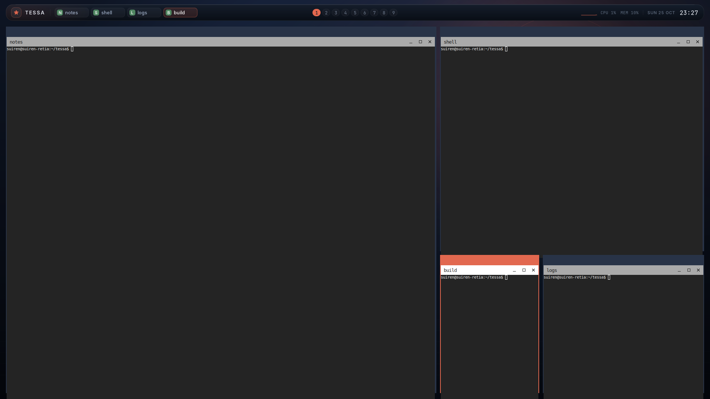
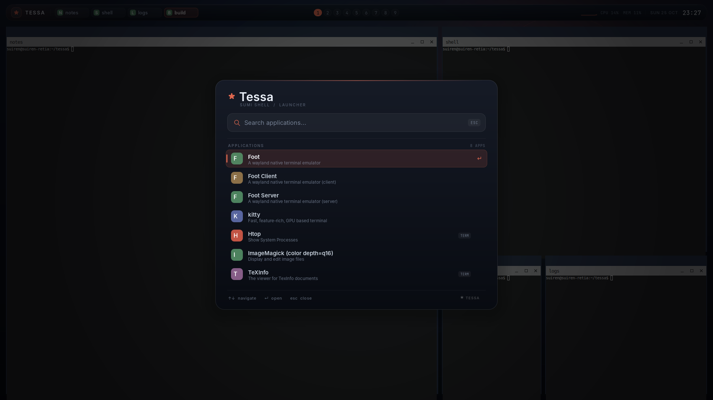
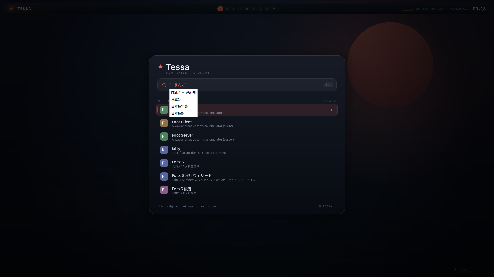
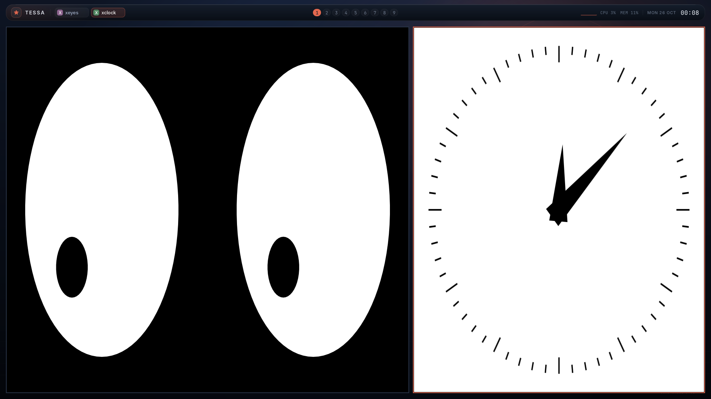
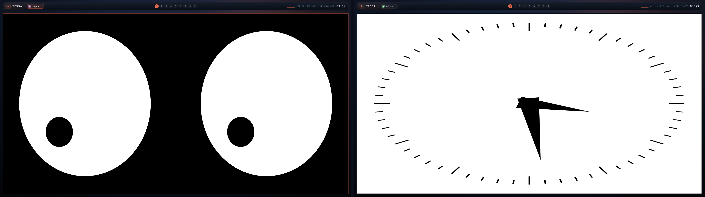
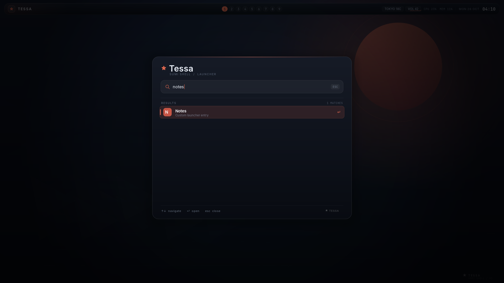

[English](README.md) | **日本語**

# Tessa

wlroots の上に Zig で実装した、静かなタイル型 Wayland デスクトップです。

Tessa はコンポジタであり、小さなシェルでもあります。フローティングタスクバー、
検索できるランチャー、壁紙、タイルレイアウト、ワークスペース、ウィンドウの
ボーダーまで、すべてこのリポジトリに含まれています。Waybar / Rofi / wofi は
必要ありません。





上のスクリーンショットは headless 開発セッションで、ターミナルに foot を使って
撮影したものです。

ビルド、インストール、全設定キー、ルール、エフェクト、IPC、イベント、
フックを一冊にまとめた
[セットアップ＆カスタマイズ完全ガイド](docs/GUIDE.ja.md) もあります。

## Ubuntu 26.04 へのインストール

[v0.1.0 リリースページ](https://github.com/Keychrom/Tessa/releases/tag/v0.1.0)
に amd64 用のビルド済みパッケージがあります。通常はこの方法を推奨します。
バイナリパッケージの利用に Zig や wlroots の開発ヘッダーは不要です。

```sh
sudo apt update
sudo apt install curl
curl -fLO https://github.com/Keychrom/Tessa/releases/download/v0.1.0/tessa_0.1.0_amd64.deb
curl -fLO https://github.com/Keychrom/Tessa/releases/download/v0.1.0/SHA256SUMS
grep ' tessa_0.1.0_amd64.deb$' SHA256SUMS | sha256sum -c -
sudo apt install ./tessa_0.1.0_amd64.deb
```

`apt` が実行時ライブラリ、コンポジタ、パネル、CLI、セッションエントリ、
設定例、ポータル設定、man ページを導入します。実用的な追加パッケージ:

```sh
sudo apt install kitty wlr-randr grim dbus \
  fcitx5 fcitx5-mozc \
  xdg-desktop-portal xdg-desktop-portal-wlr pipewire
```

`xwayland-satellite` は Ubuntu 26.04 のパッケージにはないため、X11
アプリケーションが必要なら上流から導入してください。既定の
`xwayland = true` のまま satellite がない場合は警告が出ます。

ログアウトし、GDM / SDDM などのセッション選択で **Tessa** を選びます。
`.deb` が `/usr/share/wayland-sessions/tessa.desktop` を導入するので、
下のソース用セッションインストーラーは開発時だけ必要です。

TTY で最初の動作確認をする場合:

```sh
tessa
```

終了は `Super+Shift+E` です。パッケージの確認:

```sh
dpkg -s tessa
tessa-ctl config-check
```

以前 `/usr/local` に手動インストールしたTessaがある場合は、どちらか一方に
揃えてください。通常は `/usr/local/bin` が `/usr/bin` より先に来るため、
手動版のバイナリが使われ続けます。

## Arch Linux へのインストール

Tessa は Zig **0.16** と wlroots **0.19** を要求します。Arch 公式リポジトリの
`zig` は 0.17、wlroots は `wlroots0.20`（0.20 系）で、このツリーとは ABI
互換性がありません。ビルド前に AUR の `zig0.16-bin`（`zig0.16` を提供し、
`/usr/bin/zig-0.16` を導入）と `wlroots0.19` を入れてください。

paru などの AUR ヘルパーを使う場合:

```sh
sudo pacman -Syu --needed base-devel git
paru -S --needed zig0.16-bin wlroots0.19
```

AUR ヘルパーを使わない場合は、次の 2 パッケージを手動でビルドします:

```sh
sudo pacman -S --needed base-devel git meson ninja glslang \
  vulkan-headers wayland-protocols xorg-xwayland minisign
mkdir -p ~/aur && cd ~/aur
for pkg in zig0.16-bin wlroots0.19; do
  git clone "https://aur.archlinux.org/$pkg.git"
  (cd "$pkg" && makepkg -si)
done
```

続いて Tessa の PKGBUILD からインストールします:

```sh
git clone https://github.com/Keychrom/Tessa.git
cd Tessa/packaging/arch
makepkg -si
```

`tessa-git` パッケージはコンポジタ、パネル、CLI、セッションエントリ、
設定例、ポータル設定、man ページ、ドキュメントを `/usr` 以下へ導入します。
`makepkg` は AUR 依存パッケージを自動取得しないため、先に
`zig0.16-bin` と `wlroots0.19` を入れてください。確認:

```sh
tessa-ctl config-check
command -v tessa tessa-panel tessa-ctl
```

実用的な追加パッケージ:

```sh
sudo pacman -S --needed kitty wlr-randr grim dbus fcitx5 fcitx5-mozc \
  xdg-desktop-portal xdg-desktop-portal-wlr pipewire
```

X11 アプリケーションには AUR の `xwayland-satellite-git` を導入します。
`scenefx0.4` は `-Dscenefx=true` のカスタムビルド専用で、PKGBUILD の既定
ビルドでは角丸もブラーも有効になりません。TTY にログインして `tessa` を
実行するか、ディスプレイマネージャーで **Tessa** を選んでください。

Arch パッケージはまだ実機の Arch で検証していません。`makepkg` が依存
関係や ABI の不一致を報告した場合は、コンパイラが `zig-0.16` で、
`pkg-config --modversion wlroots-0.19` が `0.19.x` を返すことを確認して
ください。

Arch で **Debug** ビルドを行うと
`unhandled relocation type R_X86_64_PC64 ... Scrt1.o:.sframe` で失敗する
ことがあります。Zig 0.16 のリンカーと glibc 2.43 / GCC 16 の組み合わせに
よる制限です。現在の `build.zig` は LLVM/LLD を強制しているため、ツリーを
更新してください。古いツリーでは `-Doptimize=ReleaseSafe` で回避できます。

## 状態

MVP（`0.1.0`）ですが、日常的に使えるレベルまで中核機能は実装されています。

- Zig による wlroots 0.19 コンポジタ（DRM / headless / ネストした Wayland
  バックエンドを wlroots が自動判定）
- xdg-shell トップレベル、layer-shell、data-device と primary-selection
  （クリップボード）、xdg-activation、xdg-decoration、cursor-shape-v1、
  wlr-screencopy（grim が動作）
- マスター/スタック、Tessa 独自の「モザイク」スパイラル、グリッド、
  等幅カラムの各レイアウト。ワークスペースごとのレイアウト/隙間/マスター
  比率、マスター列の数、モザイク比率/最小サイズ、グリッド列数も設定可能
  （`Super+T` で巡回）。実行中に選んだレイアウトは再起動後も復元され、
  設定の再読み込みは上書きしていないワークスペースだけを更新
- app-id/タイトル/出力、または真偽値と POSIX 正規表現の式でマッチする
  宣言的ウィンドウルール。フローティング、ワークスペース、フルスクリーン、
  サイズ、位置、ウィンドウ別ボーダー色、不透明度、角丸、ブラー、影、
  ボーダー幅を指定可能。namespace/出力/レイヤーでマッチするレイヤーシェル
  ルールにも対応
- 独自タイルアルゴリズム向けの外部レイアウトヘルパー v2。出力ごとの非同期
  プロセス、リクエスト合流、フォーカス／緊急度メタデータ、バージョン
  ネゴシエーション、タイムアウト、再起動、内蔵レイアウトへのフォールバック
- 行番号付きの設定診断、設定のアトミック保存時の自動リロード、失敗時に
  旧設定を維持するトランザクショナルなリロード、外部ツール向けの
  バージョン付き JSON 状態/設定スナップショット。ワークスペース別・出力別の
  レイアウト/隙間/マスター設定と、アニメーションライフサイクルフック
- 出力/ワークスペースルールから参照する名前付きレイアウトプロファイルと、
  出力別の背景・ボーダー・壁紙・パネル寸法テーマルール
- デバイス別の libinput ポリシー（タッチパッド/マウスなどのタップ、
  ドラッグ、自然スクロール、加速、スクロール/クリック方式、ボタンマップ、
  キー入力中のタッチパッド無効化）。設定リロードで反映し、ルールを削除すると
  元の状態へ復元。コネクタ名または EDID の make/model/serial で一致させる
  モニタールール、VRR/Adaptive Sync、カーソルテーマ/サイズにも対応
- 式で絞り込めるイベント→コマンドルール（ポリシー自動化）
- 名前付き入力モードと、モード固有のキーバインド、リーダーキー、
  `enter-mode`、モードごとのタイムアウト
- アクセント、ボーダー、壁紙、パネル向けの意味論的テーマロール
- バーの高さ、上下左右のマージン、バー背景色/前景色を設定可能
- ウィンドウを開く/ワークスペース切り替え時のスライドアニメーション
  （種類別の再生時間、名前付き cubic-bezier/スプリングカーブ、ウィンドウ別の
  有効化・時間・カーブ上書き、開始オフセット）、
  閉じる際のスケール/フェードスナップショット、視差効果低減時のフェード、
  レイヤー化したソフトなウィンドウシャドウ、任意で有効にできる scenefx の
  角丸と背景ブラー（ウィンドウとシェルサーフェス）、壁紙グラデーション色、
  PNG 壁紙（cover/contain/stretch）、アート表示のオン/オフ設定
- 出力ごとに 9 ワークスペース、フローティング、フルスクリーン、クリックで
  フォーカス。任意のグローバル名をバー表示、バインド、IPC、ウィンドウルールで
  利用可能。出力ごとのフローティングスクラッチパッドと、ワークスペース単位の
  タブ付きウィンドウグループも使用可能
- マルチモニタ対応: 各出力にバー/壁紙と独立したアクティブワークスペースを
  持ち、パネルも出力ごとに自動起動。ワークスペースの出力固定、`wlr-randr`
  による出力管理、設定の永続化、`wp_fractional_scale_v1` による
  フラクショナルな Wayland スケーリング、整数倍の HiDPI パネルバッファ
  スケーリングに対応
- 外部プロセス向け拡張 API: 行イベント、リクエスト ID とケイパビリティを
  持つ JSON-RPC、JSON イベント通知、設定フックとイベントルール、
  バーへのカスタムステータス、ランチャー項目、自動化クライアント
  `tessa-ctl`
- ゲームやポインタルック向けの `relative-pointer-v1`
- スクリプトからのポインタ操作と headless テスト向けの
  `wlr-virtual-pointer-v1`
- `pointer-constraints-v1` の locked/confined ポインタ。ウィンドウの
  フォーカスに合わせて有効化
- タッチパッドジェスチャ: 3 本指（設定可能）の横スワイプでワークスペース、
  上スワイプでランチャー。それ以外の指の本数とピンチ/ホールドは
  フォーカス中のクライアントへ転送
- タッチ入力（パネル UI を含む）と tablet-v2 のペン/パッド対応
  （筆圧、傾き、回転、ツールボタン、リング、ストリップ）
- サードパーティクライアントの layer-shell ポップアップ（パネルのメニューや
  ドロップダウン）
- `ext-session-lock-v1` によるセッションロック。`ext-idle-notify-v1`、
  `idle-inhibit-v1`、出力電源管理にも対応し、swayidle や wlopm と連携可能
- 設定ファイルでキーボードレイアウト/バリアント/オプションとキーリピートを
  設定可能。`Super+R` で再読み込み
- text-input-v3 + input-method-v2 による IME リレーと入力ポップアップの配置。
  Fcitx5 + Mozc でランチャーおよび Wayland クライアントへの日本語入力を
  headless 環境で確認済み
- `xwayland-satellite` による XWayland。ルートレス X11 アプリを通常の Tessa
  トップレベルとして管理し、起動したアプリへ `DISPLAY` を継承
- XIM 統合: X11 クライアント向けに `XMODIFIERS` をエクスポートし、
  必要なら `xim_start` で X ディスプレイ出現後に入力メソッドを起動
- Zig + Cairo/Pango による統合パネル
  - 墨と朱の壁紙
  - ワークスペースピル、ウィンドウチップ、時計、CPU/RAM を表示する
    フローティングタスクバー
  - キーボード操作と IME 入力に対応した検索型ランチャー
  - 月間カレンダーの時計ポップアップと、ロック/サスペンド/再起動/電源オフの
    コマンドを設定できる電源メニュー
  - `Super+V` で開き、クリックまたはキーボードで貼り付けられるメモリ上だけの
    クリップボード履歴
  - `wlr-screencopy` を使った範囲/全画面スクリーンショット UI（PNG 保存）
  - `org.freedesktop.Notifications` サービス。アクションボタン、
    `default` アクティベート、image-data/icon-name アイコン、Pango
    マークアップ、置換/閉じる/期限切れ、フォーカス出力へのルーティングに
    対応したトースト通知
  - バッテリーとデフォルトルートのネットワーク表示
  - MPRIS メディアチップと操作（`Super+M`）
  - StatusNotifier トレイの watcher/host、アイコン描画、アクティベート
    （`Super+Shift+T`）
  - `wpctl` / `pactl` / `amixer` を使った音量表示とポップオーバー
    （`Super+Shift+A`）、コマンド上書き設定つき
  - `xdg-desktop-portal` 連携: `xdg-desktop-portal-wlr` と PipeWire による
    画面共有のための screencopy、dmabuf、出力キャプチャソース、
    image-copy capture、foreign-toplevel リスト
- 状態/イベントを明示的に購読する行ベース IPC と `tessa-ctl` CLI
- include とイベントフックに対応した行ベース設定ファイル

Ubuntu 26.04、Zig 0.16.0、wlroots 0.19.2 でビルド・動作確認しています。
確認は主に headless の pixman バックエンドで、`grim`、`wtype`、Fcitx5 +
Mozc、`xwayland-satellite` 経由の X11 クライアントを使用しました。2 出力の
headless 環境で、出力ごとのワークスペース/パネル、両出力のセッションロック、
`wlr-randr` による出力管理も確認しています。イベントフック、イベント
ストリーム、カスタムステータス、カスタムランチャー項目、設定再読み込みは
`tests/smoke.sh`、`tests/output-persistence.sh`、パネルのスクリーンショットで
確認しました。ワークスペースごとの master/mosaic/grid/columns レイアウト、
2 倍 HiDPI パネル、フラクショナルな出力スケール変更、再起動後の出力
モード/位置/スケール/レイアウト復元も
`tests/smoke.sh`、`tests/output-persistence.sh`、`tests/layout-geometry.sh`、
`tests/customization.sh`、`tests/layout-helper.sh`、
`tests/layout-helper-v2.sh`、`tests/config-validation.sh`、
`tests/config-watch.sh`、`tests/json-ipc.sh`、`tests/modes.sh`、
`tests/panel-theme.sh`、
`tests/panel-popovers.sh`、`tests/clipboard.sh`、`tests/screenshot.sh`、
`tests/notifications.sh`、`tests/notification-routing.sh`、
`tests/system-status.sh`、`tests/media.sh`、`tests/tray.sh`、
`tests/audio.sh`、`tests/foreign-toplevels.sh`、`tests/animations.sh`、
`tests/motion.sh`、`tests/motion-overrides.sh`、`tests/effects.sh`、
`tests/rule-visuals.sh`、
`tests/input.sh`、`tests/pointer-constraints.sh`、
`tests/xim.sh`、`tests/fractional-scale.sh`、`tests/workspace-pinning.sh`、
`tests/output-rules.sh`、`tests/rule-expressions.sh`、`tests/event-rules.sh`、
`tests/output-themes.sh`、`tests/theme-roles.sh`、`tests/reduced-motion.sh`、
`tests/profiles.sh`、`tests/json-rpc.sh`、`tests/interaction.sh`、
`tests/popups.sh`、`tests/portal.sh` で
検証しています。`tests/effects.sh` は `-Dscenefx=true` ビルドでのみ角丸を
検査し、それ以外ではスキップします。ポータルのテストはポータルと PipeWire がインストール
されている場合に ScreenCast を端から端まで実行し、なければスキップします。
**DRM/tty と実際のキーボード・マウスでの検証は、まだ実機で行う必要があります。**
[既知の制限](#既知の制限)も参照してください。

## なぜもう 1 つのタイル型 WM なのか

Tessa の目的は Hyprland を機能で上回ることではありません。より小さく、
まとまりのあるデスクトップを目指しています。

- **統合されたシェル。** バー、ランチャー、壁紙、タイル配置が 1 つの
  プロジェクトにまとまっています。色と挙動が統一されているのは、それが
  同じコードだからです。
- **違うレイアウト。** マスター/スタックに加えて、渦巻き状の「テセラ」
  モザイク、均等グリッド、等幅カラムがあります（`Super+T` で巡回）。Tessa
  という名前は tessellation（タイル張り）に由来します。
- **墨絵の視覚言語。** 藍色の紙、墨だまり、朱色の太陽、粒子、ガラスのような
  フローティングバー。一般的なステータスバーにテーマを載せただけのものでは
  ありません。
- **小さく直接的な実装。** Zig + wlroots、Pango/GDBus/ミキサーコマンド用の
  小さな C シム、行ベースの設定と IPC。余計なレイヤーをできるだけ挟みません。
- **JavaScript / TypeScript ランタイムなし。** ShojiWM のようにシェルを TSX
  で自由に書くのではなく、固定された小さなシェルと設定を持ちます。ピクセル
  単位で UI をプログラムしたいなら ShojiWM、アニメーション・ブラー・巨大な
  プラグインエコシステムが欲しいなら Hyprland の方が適しています。Tessa は
  「静かで統合されていて、Zig で Hack できるコンポジタ」という niche に
  位置します。

ターミナルをゼロから実装することは意図的に避けています。デフォルトは
**kitty** です。foot が好みなら設定で `terminal = foot` にしてください。

## ソースからビルド（開発向け）

開発、Ubuntu 26.04 / Arch Linux 以外、または scenefx のカスタムビルドでは
こちらを使います。通常利用なら、それぞれのディストリビューション向けの
`.deb` または Arch の `tessa-git` パッケージで十分です。

必要なもの:

- Zig **0.16.0**（Ubuntu 26.04 の `zig` パッケージは 0.14 なので不足です）
- wlroots **0.19** の開発ファイル（`pkg-config --modversion wlroots-0.19`
  で見つかること）
- Wayland、xkbcommon、pixman、libdrm、libinput、libseat、libudev、EGL/GLES
- パネルと通知用の Cairo / Pango / GLib (GIO) 開発ファイル
- フォント: Inter、JetBrains Mono、Noto Sans CJK JP などの CJK フォント
- 任意: [`xwayland-satellite`](https://github.com/Supreeeme/xwayland-satellite)
  （X11 アプリ用。`xwayland = true` で自動起動）
- 任意: Fcitx5 + Mozc（または `zwp_input_method_v2` を実装した他の IME）
- 任意: 実行中の出力モード/位置/スケール変更用の `wlr-randr`
- 任意: 角丸と背景ブラー用の [scenefx](https://github.com/wlrfx/scenefx)
  **0.4.1**（`pkg-config --modversion scenefx-0.4`）
- 任意: デスクトップ通知、トレイ、ポータル用の D-Bus セッション bus
- 任意: 音量操作用の `wpctl`（PipeWire）、`pactl`（PulseAudio）、
  `amixer`（ALSA）
- 任意: 画面共有用の `xdg-desktop-portal`、`xdg-desktop-portal-wlr`、
  PipeWire（下記の `tessa.portal` を配置）

配布用パッケージ定義は `packaging/` と `debian/` にあります。
`packaging/arch/PKGBUILD` と debhelper 用 `debian/` が、コンポジタ、パネル、
CLI、セッションファイル、設定例、ポータル設定をインストールします。
Debianバイナリパッケージを作る場合:

```sh
ZIG="$HOME/.local/zig-0.16.0/zig" ./scripts/build-deb.sh
# 生成物: dist/tessa_<version>_<arch>.deb
```

詳細は [packaging/README.md](packaging/README.md) を参照してください。

画面共有には `xdg-desktop-portal`、`xdg-desktop-portal-wlr`、PipeWire が
必要です。同梱の `packaging/portal/tessa.portal` をシステムへ入れると
`/usr/share/xdg-desktop-portal/portals/tessa.portal` になり、
`XDG_CURRENT_DESKTOP=Tessa` で Screenshot / ScreenCast を wlr バックエンドへ
振り分けます。xdpw にはソース選択が必要です。モニターが 1 台なら
`~/.config/xdg-desktop-portal-wlr/config` に `chooser_type=none` と
`output_name=<出力名>` を設定してください。

Ubuntu 26.04 の場合:

```sh
sudo apt install build-essential pkg-config git \
  libwayland-dev wayland-protocols libwlroots-0.19-dev \
  libxkbcommon-dev libpixman-1-dev libdrm-dev libinput-dev \
  libseat-dev libudev-dev libegl-dev libgles2-mesa-dev \
  libcairo2-dev libpango1.0-dev libglib2.0-dev libfontconfig1-dev \
  fonts-inter fonts-jetbrains-mono fonts-noto-cjk \
  xwayland xauth xterm fcitx5 fcitx5-mozc
```

Arch Linux では上記「Arch Linux へのインストール」の手順で AUR の
`zig0.16-bin` と `wlroots0.19` を導入してください。
`scripts/build.sh` は `/usr/bin/zig-0.16` を自動的に優先し、
`ZIG=/path/to/zig` で上書きできます。Arch 公式の `zig` 0.17 と
`wlroots0.20` はこのビルドには使えません。

`xwayland-satellite` はすべてのディストリビューションにパッケージされている
わけではありません。`PATH` の通った場所（例:
`~/.local/bin/xwayland-satellite`）にインストールするか、
`TESSA_XWAYLAND_BIN` に絶対パスを設定してください。Tessa は wlroots 内蔵の
XWayland ではなく satellite を使います。satellite がルートレス X11
ウィンドウを通常の xdg-shell トップレベルとしてコンポジタに渡します。

wlroots 0.19 を `/usr/local` 以下にソースからインストールした場合は、
`.pc` ファイルと共有ライブラリが見つかることを確認してください:

```sh
pkg-config --modversion wlroots-0.19
ldconfig -p | grep wlroots
```

ビルド:

```sh
chmod +x scripts/*.sh scripts/tessa-session   # 実行権限が失われている場合
./scripts/build.sh -Doptimize=ReleaseSafe
```

角丸と背景ブラーは scenefx を使うオプトイン・ビルドです。scenefx 0.4.1
（wlroots 0.19 系）を導入してから次を実行します:

```sh
./scripts/build.sh -Doptimize=ReleaseSafe -Dscenefx=true
```

このバイナリはシーンとレンダラーが scenefx の GLES2 経路に切り替わり、
`WLR_RENDERER=pixman` は使えません。既定ビルドは upstream wlroots の
シーンを使い、GL とソフトウェアレンダリングの両方をサポートします。
scenefx をシステム以外の prefix に入れた場合は、ビルド時と実行時に
pkg-config とライブラリのパスを設定してください。

生成されるもの:

- `zig-out/bin/tessa` — コンポジタ
- `zig-out/bin/tessa-panel` — シェルパネル（出力ごとに 1 プロセス、Tessa が自動起動）
- `zig-out/bin/tessa-ctl` — スクリプト/拡張向けの状態・イベント・自動化クライアント

生成済みの Wayland プロトコルヘッダーは `protocol/` にコミットされているので、
wlroots 側に `xdg-shell-protocol.h` がなくてもビルドできます。

## 実行

### TTY から（最初のテストに推奨）

SSH 越しではなく、対象マシンのコンソールにログインし、アクティブな仮想
ターミナルから実行します。パッケージ版なら:

```sh
tessa
```

ソースビルドなら:

```sh
cd /path/to/Tessa
PATH="$PWD/zig-out/bin:$PATH" ./zig-out/bin/tessa
```

wlroots が DRM バックエンドと libinput を自動検出します。Tessa は `PATH` から
出力ごとに 1 つずつ `tessa-panel` を起動するので、`zig-out/bin` を通すか、
バイナリをインストールしてください。デフォルトのターミナルは `kitty` です。
インストールするか、設定で `terminal = foot` に変更してください。

### ディスプレイマネージャ / セッションファイル

バイナリパッケージはセッションエントリを導入済みです。この手順はソース
ビルドから実行する場合だけ使います:

```sh
# ~/.local にインストール
./scripts/install-session.sh

# システム全体にインストール
sudo PREFIX=/usr/local ./scripts/install-session.sh
```

ログアウトし、GDM / SDDM / greetd で **Tessa** を選択してください。セッション
ファイルは `tessa-session` を実行し、自分自身のディレクトリを `PATH` の先頭に
追加してから `tessa` を起動します。

### SSH 越しの headless 開発

開発で使っている headless ワークフローです。まずコンポジタを起動します:

```sh
./scripts/run-headless.sh
```

別のシェルでスクリーンショットを撮ります:

```sh
./scripts/screenshot.sh /tmp/tessa.png
```

headless バックエンドには物理入力デバイスがないため、Tessa は標準 XKB
キーマップを持つフォールバックキーボードを作成します。これによりパネル、
IME、XWayland が正しく起動できます。マウスや状態変更は IPC、キーボード入力は
`wtype` で注入します:

```sh
XDG_RUNTIME_DIR=/tmp/tessa-headless WAYLAND_DISPLAY=wayland-0 \
  wtype "foot"
XDG_RUNTIME_DIR=/tmp/tessa-headless WAYLAND_DISPLAY=wayland-0 \
  wtype -k Return
```

`wtype` は virtual-keyboard プロトコルで接続し、現在キーボードフォーカスを
持つサーフェスへ入力します。TTY なしで IME やパネルのキーボード経路を
テストするときにも使います。

headless ワークフローの詳細は
[docs/DEVELOPMENT.ja.md](docs/DEVELOPMENT.ja.md)、拡張 API は
[docs/EXTENDING.ja.md](docs/EXTENDING.ja.md) を参照してください。

## 入力メソッド（IME）



Tessa は `zwp_text_input_v3`（クライアント側）と `zwp_input_method_v2`
（入力メソッド側）を実装し、フォーカス、周辺テキスト、カーソル矩形、
プリエディット、確定文字列、削除をリレーします。入力メソッドのポップアップ
サーフェス（候補ウィンドウ）はテキストカーソルの下に配置され、画面端では
クランプされます。

**Fcitx5 + Mozc** で動作確認しています:

```sh
sudo apt install fcitx5 fcitx5-mozc
```

Tessa セッション内で Fcitx5 を起動してください（`TESSA_STARTUP` や
コンポジタの spawn コマンドなど）。Wayland ネイティブのクライアントでは
`GTK_IM_MODULE` / `QT_IM_MODULE` を設定する必要はありません。これらは
Wayland の text-input プロトコルを使うためです。X11 クライアント向けには
Tessa が `XMODIFIERS=@im=fcitx`（`xim_server` で変更可能）をエクスポートし、
`xim_start = fcitx5 -d` を設定すると X ディスプレイの準備後に XIM サーバを
自動起動します。Fcitx5 での登録は確認済みですが、実際の確定処理は各 X11
ツールキットの XIM クライアントに依存します。

`Super+D` でランチャーを開いて入力すると、プリエディットが検索欄に描画され、
その下に Fcitx の候補ポップアップが表示されます。`Enter` で選択を確定し、
確定した文字列がランチャーの検索語に追加されます。

## X11 アプリケーション



Tessa は Wayland ソケットの準備後に `xwayland-satellite` を起動し、選んだ
ディスプレイを `DISPLAY` としてエクスポートします。X11 アプリケーションは
ルートレスで動作し、各 X11 トップレベルは通常の Tessa ウィンドウとして
タイル、ワークスペース、フォーカス、タスクバーに参加します。Tessa は
`xdg-decoration` をサーバーサイドモードで広告するため、satellite は独自の
タイトルバーを描画しません。代わりに Tessa のアクセントカラーのボーダーが
使われます。

デフォルトではディスプレイを自動選択します（`xwayland_display = auto`）。
`:0` から順に、ソケットが存在しないディスプレイを選びます。必要なら `:1`
などの明示的な値を設定してください。XWayland を無効にするには
`xwayland = false` または `TESSA_NO_XWAYLAND=1` を使います。satellite が
`PATH` の外にある場合は
`TESSA_XWAYLAND_BIN=/path/to/xwayland-satellite` を設定してください。

XWayland のスケーリングは `xwayland-satellite` に委譲します。Tessa は
`wp_fractional_scale_v1` と `wp_viewporter` を広告するため、satellite は
X11 クライアントをフラクショナルな出力スケールに合わせて拡大できます。
XSETTINGS を無視するツールキットは 1 倍のまま表示される場合があります。
フラクショナルな X11 表示は satellite を導入した環境で追加検証が必要です。

## ロックと idle

Tessa は `ext-session-lock-v1`、`ext-idle-notify-v1`、`idle-inhibit-v1` を
実装しています。ロッククライアントと idle デーモンは別のプログラムです:

```sh
sudo apt install swaylock swayidle
```

デフォルトでは `Super+Escape` が `swaylock` を起動します。別のロッカーを
使う場合は `bind = SUPER+Escape spawn <command>` で変更してください。ロック中は
通常のデスクトップのシーンツリーが隠れ、仮想キーボードからの入力は無視され、
ロックサーフェスがキーボード/ポインタフォーカスを受け取ります。ロック
クライアントがロック中に終了した場合、Tessa はデスクトップを露出させず
セッションを終了します。

`swayidle` と `wlopm` を組み合わせると、idle 時のロックと DPMS を自動化
できます:

```sh
sudo apt install wlopm
swayidle -w \
  timeout 300 'swaylock -f' \
  timeout 600 'wlopm --off "*"' \
  resume 'wlopm --on "*"'
```

idle 通知と inhibitor は動作し、動画プレイヤーなどは `idle-inhibit-v1` で
idle を抑制できます。Tessa は出力電源管理プロトコルも実装しているため、
`wlopm` で出力をオフ/オンできます。

## マルチモニタ



各出力に独立した壁紙、バー、アクティブワークスペースがあります。
`Super+1` … `Super+9` はフォーカス中の出力のワークスペースを変更します。
`workspace_pin = OUTPUT WORKSPACE` を設定するとその対象が上書きされ、
ショートカットとバーは常に固定先のモニタへ切り替えます。ピン留めした
ワークスペースへウィンドウを移動すると、その出力へ移ります。
バーをクリック/スクロールすると、そのモニタのワークスペースを変更し、
その出力へフォーカスします。ランチャーはフォーカス中の出力に開き、新しい
ウィンドウもそこに配置されます。`Super+Shift+H/J/K/L` はまず同じ出力内で
入れ替え、その方向にウィンドウがない場合はフォーカス中のウィンドウを隣の
モニタへ移動します。

Tessa は `TESSA_PANEL_OUTPUT=<name>` を設定して、出力ごとに 1 つの
`tessa-panel` を自動起動します。自動起動を無効にした場合（`panel = false`
または `TESSA_NO_PANEL=1`）は、出力ごとに手動で起動してください:

```sh
TESSA_PANEL_OUTPUT=HEADLESS-1 tessa-panel
```

出力のモード、位置、スケール、変換は `wlr-randr` で変更できます。Tessa は
`wlr-output-management-unstable-v1` を実装しています。適用した設定は
`$XDG_CONFIG_HOME/tessa/outputs.conf`（または
`~/.config/tessa/outputs.conf`）に保存され、出力が再び現れたときに復元
されます。保存先はメイン設定の `output_config` または
`TESSA_OUTPUT_CONFIG` で変更できます。`wp_fractional_scale_v1` に対応する
Wayland クライアントには、実行中の変更を含めて正確な出力スケールが通知
されます。プロトコル非対応のクライアントは出力スケールの切り上げ値を
使います。パネルは切り上げ値を Cairo の整数バッファスケールとして使うため、
整数倍では鮮明、フラクショナルではダウンサンプルされます。XWayland の
スケーリングは `xwayland-satellite` が同じフラクショナルスケールを利用して
処理します。

## 拡張



Tessa はプラグイン VM を埋め込みません。拡張はコンポジタの Unix ソケット API
を話す通常のプロセスで、任意の言語で書けます。`tessa-ctl` が状態
スナップショット、構造化イベント、ステータス、コマンド操作を公開します。

```sh
tessa-ctl state
tessa-ctl state --json
tessa-ctl config
tessa-ctl config --json
tessa-ctl config-check
tessa-ctl events window-focus
tessa-ctl status weather "Tokyo 18C"
tessa-ctl layout grid
tessa-ctl dispatch reload
```

`state --json` と `config --json` はツール向けのスキーマバージョン付き
スナップショットを返します。`config-check` はファイル名/行番号付きの診断を
表示し、読み込み済み設定にエラーがある間は非ゼロで終了します。設定から
ログイン時のコマンド起動やイベントへの反応もできます。

```ini
startup = fcitx5 -d
hook = window-open notify-send "Window opened" "$TESSA_TITLE"
hook = animation-done echo "$TESSA_ARG $TESSA_WINDOW_ID" >> ~/.cache/tessa-animations.log
hook = close-animation-done echo "closed $TESSA_WINDOW_ID" >> ~/.cache/tessa-animations.log
launcher_entry = Notes | foot -e nvim ~/notes.md
include = /home/you/.config/tessa/launcher-entries.conf
```

パネルは最大 8 件の拡張ステータスを表示し、クリック時にコマンドを実行できます。
イベントスキーマ、フックの環境変数、ステータス API の詳細は
[docs/EXTENDING.ja.md](docs/EXTENDING.ja.md) にあります。

## キーバインド

| バインド | 動作 |
| --- | --- |
| `Super+Return` | ターミナル（設定の `terminal`） |
| `Super+D` | ランチャー |
| `Super+V` | クリップボード履歴 |
| `Super+Shift+S` | 範囲/全画面スクリーンショット |
| `Super+M` | MPRIS メディア操作 |
| `Super+Shift+T` | StatusNotifier トレイ |
| `Super+Shift+A` | 音量操作 |
| `Super+T` | マスター → モザイク → グリッド → カラムを巡回 |
| `Super+Q` | フォーカス中のウィンドウを閉じる |
| `Super+Shift+E` | Tessa を終了 |
| `Super+R` | 設定を再読み込み |
| `Super+1` … `Super+9` | ワークスペースを切り替え |
| `Super+Shift+1` … `Super+Shift+9` | ウィンドウをワークスペースへ移動 |
| `Super+H/J/K/L` | 左/下/上/右のウィンドウへフォーカス |
| `Super+Shift+H/J/K/L` | その方向のウィンドウと入れ替え。ない場合は隣の出力へ移動 |
| `Super+Space` | フローティング切り替え |
| `Super+F` | フルスクリーン切り替え |
| `Super+grave` | スクラッチパッド表示切り替え |
| `Super+Shift+grave` | フォーカス中ウィンドウをスクラッチパッドへ移動／復帰 |
| `Super+Shift+G` | ワークスペースのタイルウィンドウをグループ化／解除 |
| `Super+Escape` | セッションをロック（`swaylock` を実行。要インストール） |
| `Super+Tab` / `Super+Shift+Tab` | ウィンドウを巡回。グループのフォーカス中はタブを巡回 |
| `Super+Ctrl+H/L` | マスター領域の比率を縮小/拡大 |
| `Super+Alt+H/L` | フローティングウィンドウの幅を縮小/拡大 |
| `Super+Alt+J/K` | フローティングウィンドウの高さを拡大/縮小 |

マウス:

- ウィンドウをクリックするとフォーカスします。タスクバーのチップをクリック
  するとそのウィンドウへフォーカスします。
- タスクバーのチップを右クリックするとそのウィンドウを閉じます。
- バーの上でスクロールするとワークスペースを巡回します。
- `Super+左ドラッグ` でフローティングウィンドウを移動、`Super+右ドラッグ` で
  リサイズします。
- クライアントサイドのタイトルバードラッグもフローティングウィンドウでは
  使えます。
- 花びら/`TESSA` のマークをクリックするか、`Super+D` でランチャーを開きます。
- `TESSA` マークを右クリックすると電源メニュー、時計をクリックすると
  カレンダーが開きます。`tessa-ctl panel calendar|power|clipboard` でも
  開けます。
- ランチャー内では入力で検索、`Up`/`Down`、`Enter`、`Esc`、または行の
  クリックで操作します。
- カレンダーでは `Left`/`Right` または矢印ボタンで月を移動し、`Home` で
  今日に戻ります。電源メニューでは `Up`/`Down`、`Enter`、`Esc`、または
  クリックで操作します。
- `Super+V` でクリップボード履歴が開きます。`Up`/`Down` と `Enter`、
  またはクリックで選んだ項目をクリップボードへ戻せます。履歴は最大 8 件、
  各 16 KiB までのテキストで、メモリ上にのみ保持します。
- `Super+Shift+S` でスクリーンショット UI が開きます。ドラッグで範囲選択、
  クリックで全画面、`Enter` でも全画面を保存し、`Esc` でキャンセルします。
  PNG は `screenshot_dir`（既定 `~/Pictures/Screenshots`）へ保存されます。
- MPRIS プレイヤーが動いているとバーにメディアチップが表示されます。
  クリックまたは `Super+M` で前へ/再生・一時停止/次へを操作できます。
  キーボードでは `Space`、`Left`、`Right` も使えます。
- StatusNotifier の項目はバーにアイコンとして並びます。左クリックで
  アクティベート、右クリックまたは `Super+Shift+T` でトレイポップオーバーを
  開きます。`Up`/`Down` で選択し `Enter` でアクティベートします。DBusMenu
  によるコンテキストメニューは未対応です。
- `wpctl`、`pactl`、`amixer` のいずれかがあるとバーに音量が表示されます。
  クリックまたは `Super+Shift+A` で開き、`Up`/`Down` で音量、`m` でミュート、
  `Esc` で閉じます。`volume_status`、`volume_up`、`volume_down`、
  `volume_mute` でコマンドを上書きできます。

## 設定

サンプルをコピーします:

```sh
mkdir -p ~/.config/tessa
cp config/config.example ~/.config/tessa/config
```

形式は `key = value` です。`#` で始まる行はコメントです。実行中に `Super+R`
で設定を再読み込みできます。エラーのあるリロードは拒否され、以前の設定が
維持されます。`tessa-ctl config-check` で診断を確認できます。主なキー:

| キー | 意味 |
| --- | --- |
| `terminal` | `Super+Return` と `Terminal=true` の desktop アプリで使うコマンド |
| `gaps` | タイルウィンドウ間の隙間 |
| `outer_gaps` | タイル領域の外周の隙間 |
| `border_width` | アクティブ/非アクティブの枠の太さ |
| `master_ratio` | マスター領域の比率（0.15–0.9） |
| `master_count` | マスター列に縦積みするウィンドウ数 |
| `mosaic_ratio` | モザイクのスライス比率（0.25–0.85） |
| `mosaic_min_size` | グリッドへ切り替える前の最小モザイクタイル |
| `grid_columns` | グリッドの固定列数。`0` は `ceil(sqrt(n))` |
| `layout_helper` | 出力ごとに 1 つ起動する非同期レイアウトヘルパーのコマンド |
| `layout_helper_timeout` | ヘルパー応答のタイムアウト（ミリ秒、10–1000） |
| `layout` | 既定レイアウト: `master`、`mosaic`、`grid`、`columns`、`custom` |
| `layout_1` … `layout_9` | 保存済みの上書きがないワークスペースの初期レイアウト |
| `workspace-rule` | ワークスペース別のレイアウト/隙間/マスター上書きとプロファイル |
| `output-rule` | コネクタ名または EDID で一致させる出力別のレイアウト/チューニング/テーマ/VRR 上書き |
| `profile` | ルールから参照する名前付きレイアウト/チューニングプロファイル |
| `event-rule` | 条件付きイベント→コマンドルール |
| `theme-role` | コンポジタとパネルで共有する意味論的カラー |
| `workspace_pin` | ワークスペースを出力に固定: `workspace_pin = eDP-1 3`（繰り返し可） |
| `workspace-name` | ワークスペースのグローバル名: `workspace-name = 2 Code`（繰り返し可） |
| `corner_radius` | ウィンドウの角丸半径（0〜64。scenefx ビルド） |
| `blur` | 半透明サーフェスの背景ブラー（scenefx ビルド） |
| `blur_radius` | ブラー半径（1〜32） |
| `blur_passes` | ブラー品質のパス数（1〜5） |
| `panel` | `tessa-panel` を自動起動 |
| `xwayland` | `xwayland-satellite` を起動し `DISPLAY` をエクスポート |
| `xwayland_display` | `auto`、または `:0` などの明示的なディスプレイ |
| `xim` | `XMODIFIERS` を設定し XIM サーバを任意で起動 |
| `xim_server` | `XMODIFIERS` に使う XIM サーバ名（既定 `fcitx`） |
| `xim_start` | X ディスプレイ出現後に起動する任意コマンド |
| `gestures` | コンポジタのタッチパッドスワイプを有効化 |
| `gesture_fingers` | ワークスペース/ランチャースワイプの指の本数（2–5） |
| `gesture_workspace_threshold` | ワークスペース切り替えの横スワイプ量 |
| `gesture_launcher_threshold` | ランチャーを開く上スワイプ量 |
| `touch` | タッチ入力デバイスを受け付ける |
| `tablet` | tablet-v2 のツールとパッドを有効化 |
| `pointer_constraints` | `pointer-constraints-v1` を有効化 |
| `cursor_theme` | Xcursor テーマ名。空ならシステム既定 |
| `cursor_size` | カーソルサイズ（論理ピクセル、16〜96） |
| `input` / `input-rule` | デバイス別 libinput ポリシー。繰り返し可 |
| `kb_layout` | XKB レイアウト（例: `us`、`us,de`） |
| `kb_variant` | XKB バリアント（任意） |
| `kb_options` | XKB オプション（例: `grp:alt_shift_toggle`） |
| `kb_model` | XKB モデル（任意） |
| `kb_rules` | XKB ルールファイル（任意） |
| `repeat_rate` | キーリピートの速度（回/秒） |
| `repeat_delay` | キーリピート開始までの待ち時間（ミリ秒） |
| `accent` | ボーダー、バー、ランチャーのアクセント色 |
| `bg` | 壁紙のベース背景色 |
| `wallpaper_image` | PNG 壁紙パス。グラデーション／装飾を置換 |
| `wallpaper_fit` | `cover`、`contain`、`stretch` の画像フィット |
| `font` | パネルの UI フォントファミリー |
| `include` | 別の設定ファイルを読み込む |
| `startup` | 起動時に 1 回実行するコマンド |
| `hook` | コンポジタイベントで実行するコマンド |
| `launcher_entry` | ランチャー項目を追加（`名前 \| コマンド`） |
| `output_config` | 出力モード/位置/スケール/変換とレイアウト上書きの保存先 |
| `bar_height` | バーの高さ（32〜96 論理ピクセル） |
| `bar_top_margin` | バーの上端からの距離（0〜64） |
| `bar_side_margin` | バーの左右マージン（0〜128） |
| `panel_bg` | バーの背景色 |
| `panel_fg` | バーの主要テキスト色 |
| `power_lock` | 電源メニューのロックで実行するコマンド |
| `power_suspend` | サスペンドのコマンド（既定 `systemctl suspend`） |
| `power_reboot` | 再起動のコマンド（既定 `systemctl reboot`） |
| `power_off` | 電源オフのコマンド（既定 `systemctl poweroff`） |
| `screenshot_dir` | スクリーンショット PNG の保存先（既定 `~/Pictures/Screenshots`） |
| `border_active` | フォーカス中ボーダー色（既定は `accent`） |
| `border_inactive` | 非フォーカス時ボーダー色 |
| `window-rule` | 宣言的ルール。詳細はカスタマイズガイド参照 |
| `layer-rule` | レイヤーシェルルール。詳細はカスタマイズガイド参照 |
| `workspace-rule` | ワークスペース別のレイアウト、隙間、マスター比率 |
| `mode` | 後続の `bind` が属する名前付き入力モードを開始 |
| `leader` | `leader` モードへ入るリーダーキーコード |
| `leader_timeout` | リーダーモードのタイムアウト（ミリ秒） |
| `mode_timeout` | 現在の名前付きモードのタイムアウト（ミリ秒） |

追加のバインドには XKB keysym 名を使います:

```ini
bind = SUPER+Return terminal
bind = SUPER+1 workspace 1
bind = SUPER+SHIFT+1 move-to-workspace 1
bind = SUPER+h focus left
bind = SUPER+SHIFT+h move left
bind = SUPER+ctrl+h ratio -0.03
```

利用可能なアクション: `terminal`、`spawn`、`close`、`quit`、`workspace`、
`move-to-workspace`、`focus`、`move`、`toggle-float`、`toggle-fullscreen`、
`toggle-scratchpad`、`move-to-scratchpad`、`toggle-group`、`group-next`、
`group-prev`、`group-add`、`group-remove`、
`focus-next`、`focus-prev`、`launcher`、`reload`、`ratio`、`toggle-layout`、
`set-layout`、`resize-width`、`resize-height`、`enter-mode`。

`Super+T` はフォーカス中のワークスペースのレイアウトを 4 種類巡回します。
実行中に選んだレイアウトは出力・ワークスペースごとに保持され、
`outputs.conf` に保存されます。`layout_N` は保存済み・実行中の上書きがない
ワークスペースの初期値だけを設定します。設定の再読み込みでは、上書きして
いないワークスペースだけが更新され、実行中の選択は維持されます。
`resize-width` と `resize-height` はフォーカス中のフローティングウィンドウを
ピクセル単位の差分でリサイズします。

ウィンドウルールは 1 行 1 ルールです。app-id、タイトル、出力を `*`/`?` の
パターンでマッチし、アクションを順に適用します。

```ini
window-rule = app-id=pavucontrol; float=true
window-rule = title=Picture-in-Picture; float=true; position=40,40
window-rule = app-id=firefox; workspace=2
window-rule = title=GIMP*; float=false
window-rule = match=app ~ "^firefox$" && title !~ "Private|Incognito"; workspace=2
window-rule = title=Chat*; border-active=#4cc9f0; border-inactive=#1b2a41
window-rule = app-id=mpv; opacity=0.9; border-width=0; corner-radius=0
window-rule = title=Picture-in-Picture; opacity=0.85; corner-radius=14; blur=true
```

ルールはウィンドウのマップ時と設定再読み込み時に評価されます。装飾系
アクション（色、不透明度、角丸、ブラー、影、ボーダー幅）とウィンドウ別
モーション上書き（`animation`、`animation-ms`、`animation-curve`、
種類別キー）はタイトルまたは
app-id の変更時にも再適用され、構造系アクションは次回のマップ/
リロードまで待ちます。レイヤーシェルは `layer-rule` の `namespace`、
`output`、`layer`、`opacity`、`corner-radius`、`blur` で設定できます。
`tessa-ctl config` で解析済みルール、`tessa-ctl state` で実効値を確認でき
ます。完全なリファレンスは
[docs/CUSTOMIZATION.ja.md](docs/CUSTOMIZATION.ja.md) にあります。

入力モードはバインドをまとめ、`enter-mode` で有効化します。

```ini
mode = resize
bind = h resize-width -30
bind = l resize-width 30
bind = Escape enter-mode default

mode = default
bind = SUPER+SHIFT+r enter-mode resize
```

モード中は Super なしでもそのモードのバインドがマッチします。グローバル
バインドは引き続き有効で、未割り当てのキーはフォーカス中のクライアントへ
渡ります。スクリプトからは `tessa-ctl mode resize` で切り替えられます。
アクティブモードは `tessa-ctl state` の `MODE <name>` に出ます。

ワークスペース別の調整も同じ `key=value; ...` 形式です。

```ini
workspace-rule = ws=2; layout=grid; gaps=4; outer-gaps=8; master-ratio=0.65
```

`layout = custom` でカスタムタイルを選べます。Tessa は出力ごとに非同期
ヘルパーを 1 つ起動し、アクティブなタイルウィンドウ、使用可能領域、
フォーカス／緊急度を送り、フレーム矩形を受け取ります。`Super+T` の巡回には
含まれないため、使う場合は明示的にバインドしてください。

```ini
layout = custom
layout_helper = python3 ~/.config/tessa/layout.py
layout_helper_timeout = 100
bind = SUPER+SHIFT+T set-layout custom
```

タイムアウト、クラッシュ、不正な応答、矩形不足の場合は、その配置だけ
マスターへフォールバックします。プロトコルは
[docs/CUSTOMIZATION.ja.md](docs/CUSTOMIZATION.ja.md#外部レイアウトヘルパー)
にあります。

## 仕組み

- [docs/GUIDE.ja.md](docs/GUIDE.ja.md) — 現行ツリーのセットアップと
  カスタマイズの完全ガイド
- [docs/CUSTOMIZATION.ja.md](docs/CUSTOMIZATION.ja.md) — ウィンドウルール、
  レイアウト調整、外観、カスタマイズモデル
- [docs/ARCHITECTURE.ja.md](docs/ARCHITECTURE.ja.md) — コンポーネント、
  シーングラフ、IPC、layer-shell のサイズ計算、パネル描画
- [docs/ROADMAP.ja.md](docs/ROADMAP.ja.md) — 未実装の機能と今後の予定
- [docs/DEVELOPMENT.ja.md](docs/DEVELOPMENT.ja.md) — SSH / headless 開発
  ワークフロー
- [docs/EXTENDING.ja.md](docs/EXTENDING.ja.md) — イベント、フック、
  ステータス、`tessa-ctl` による拡張

概要:

```text
tessa (wlroots コンポジタ, Zig)
  ├─ backend: DRM / headless / ネストした Wayland
  ├─ wlr_scene: 壁紙 < layer background < ウィンドウ < floating < トップバー
  │              < fullscreen < ランチャーオーバーレイ
  ├─ マスター/スタック + モザイク + グリッド + カラム、9 ワークスペース、
  │  フローティング、フルスクリーン
  └─ IPC: $XDG_RUNTIME_DIR/tessa.sock
                 ▲
tessa-panel × 出力数 (Wayland クライアント, Zig + Cairo/Pango)
  ├─ background layer（墨と太陽の壁紙）
  ├─ top layer（フローティングタスクバー）
  └─ overlay layer（ランチャー、排他的キーボード）
```

パネルはサーフェスごとに 3 枚の `wl_shm` バッファを使い、Cairo で描画し、
テキストは `panel/text.c` の小さな C シム（Pango）経由でレンダリングします。
コンポジタとパネルは意図的に単純な行プロトコルで通信します:

```text
STATE
ACTIVE 1
OCC 1 2
...
WIN\t1\t1\t1\t0\t0\tkitty\tnotes\teDP-1\t40\t30\t1100\t700
END

CMD workspace 3 eDP-1
CMD workspace Code
CMD move-workspace 3
CMD toggle-scratchpad
CMD move-to-scratchpad
CMD toggle-group
CMD group-next
CMD focus 4
CMD close 4
CMD spawn kitty
CMD launcher [query]
CMD layout [name] [output]
CMD resize <dx> <dy>
CMD float <id>
CMD quit
```

IPC ソケットは `$XDG_RUNTIME_DIR` 以下にモード `0600` で作成されます。

## 既知の制限

重要な未対応・未検証項目です。

- **DRM / キーボード / マウスは実機で未検証。** 開発は headless バックエンドで
  `wtype` / Fcitx5 とソフトウェアレンダリングを使って行っています。実際の
  ポインタ操作、デバイス別 libinput 設定、VRR/Adaptive Sync、DRM モード設定は
  物理環境でのテストが必要です。
- **フラクショナルスケーリングは部分的。** フラクショナル対応の Wayland
  クライアントには実行中の変更を含めて正確な出力スケールが通知されます。
  パネルは Cairo の整数バッファスケールを使うため、フラクショナルでは
  ダウンサンプルされます。非対応クライアントは切り上げスケールを使います。
  XWayland のスケーリングは `xwayland-satellite` に依存し、headless
  テスト環境では未検証です。
- **出力の無効化は永続化されません。** `wlr-randr --off` は実行中のみ有効で、
  保存された出力エントリは次回起動時にその出力を有効化します。
- **パネルは出力ごとに 1 プロセス。** バーが独立し、クラッシュの影響も
  そのモニタだけに収まりますが、単一のマルチサーフェスパネルよりメモリを
  使います。
- **ロック画面の検証は基本的な範囲。** `ext-session-lock-v1` を実装し、
  最小限のロッククライアントで確認していますが、実際の swaylock/PAM 環境は
  物理セッションで追加検証が必要です。ロック中にロッククライアントが
  消えた場合、Tessa は黙ってアンロックせずセッションを終了します。
- **idle のタイミングは外部ツール任せ。** Tessa は idle 通知、inhibitor、
  出力電源管理を提供します。自動ブランクやロックには `swayidle` / `wlopm`
  などを別途起動してください。
- **クリップボード履歴はテキストのみ・メモリ上のみ。** 最大 8 件、各 16 KiB
  まで保持し、ディスクには書き込みません。`wlr-data-control-v1` はセッション
  内のクライアントへ公開されるため、信頼されたアプリはキーボードフォーカス
  なしでセレクションを読めます。セッション内アプリを信頼できる前提で使って
  ください。
- **通知は意図的に最小限。** パネルが `org.freedesktop.Notifications` を所有し、
  アクション、`default` クリック、静的アイコン（`image-data` /
  `image-path` / `icon-name`）、Pango マークアップ、置換、閉じる、
  期限切れに対応します。トーストはフォーカス中の出力へルーティングされます。
  Pango が扱えない HTML、通知音、通知ごとの出力固定は未対応です。
- **ウィンドウ効果はまだシンプルです。** 開く/ワークスペース切り替えは
  設定可能な名前付き cubic-bezier／スプリングカーブ、ウィンドウ別上書き、
  オフセットでウィンドウフレームを
  スライドさせます。コンポジタ起点の閉じる操作ではウィンドウのサーフェスを
  キャプチャし、設定可能なカーブ、スケール、フェードでスナップショットを
  変化させます。クライアント自身が閉じた場合は unmap 時点でバッファが
  消えているため即時に消えます。シャドウは固定のレイヤー矩形です。
  ウィンドウ/レイヤールールでサーフェスごとの不透明度、ボーダー幅、影、
  および scenefx ビルドでは角丸とブラーも上書きできます。
  角丸と背景ブラーは `-Dscenefx=true` ビルドが必要です。そのビルドは
  scenefx の GLES2 レンダラーを使うため、pixman のソフトウェア
  レンダリングは利用できません。ブラーは半透明のクライアントとシェル
  レイヤーでのみ見えます。動きを止めるには `animations = false` または
  `reduce_motion = true` を設定します。`reduce_motion_animations = fade`
  なら閉じる際のフェードだけを残せます。
- **システム表示は基本機能のみ。** バッテリーは
  `/sys/class/power_supply`、ネットワークはデフォルトルートと `operstate` を
  使います。MPRIS は最初に見つかったプレイヤーを操作し、アルバムアートは
  表示しません。
- **トレイにはメニューがありません。** StatusNotifier の登録、pixmap/
  IconName の描画、アクティベート、ステータス、削除に対応していますが、
  DBusMenu のコンテキストメニューとセカンダリアクティベートは未対応です。
- **音量はコマンドブリッジです。** `wpctl`（PipeWire）、`pactl`
  （PulseAudio）、`amixer`（ALSA）を検出してワーカースレッドで実行します。
  どれもない環境では音量表示が出ません。パネル設定で独自コマンドも指定
  できます。
- **画面共有にはポータルパッケージが必要です。** Tessa はコンポジタ側
  （`wlr-screencopy`、利用可能なら linux-dmabuf、出力キャプチャソース、
  image-copy capture、foreign-toplevel リスト）を提供します。
  `xdg-desktop-portal`、`xdg-desktop-portal-wlr`、PipeWire をインストールし、
  同梱の `tessa.portal` を配置してください。モニターの ScreenCast は
  テストで端から端まで確認しています。ウィンドウ単位のキャプチャは
  ポータルバックエンドのプロトコル対応に依存します。
- **ガンマ補正と出力設定 UI はありません。**
- **タッチ/タブレットは実機での追加検証が必要です。** touch capability、
  シーンのヒットテスト、tablet-v2 のツール/パッド、パネルのタッチ処理は
  実装済みですが、自動テストはタッチ/タブレットのない headless 出力で
  動作します。ジェスチャのしきい値はタッチパッドごとに調整が必要な場合が
  あります。
- **XIM は登録までを検証しています。** `XMODIFIERS` の継承、X ディスプレイ
  待機、`xim_start` による Fcitx5 起動、XIM サーバ登録は確認済みです。実際の
  確定テキストは各 X11 ツールキットの XIM クライアントに依存します。
- **IME のカバー範囲。** Wayland の text-input-v3 クライアントとパネルは
  Fcitx5 + Mozc で確認済みです。特殊なレイアウトのデッドキー、
  スクロール中の入力ポップアップ再配置は未確認です。
- **XWayland には `xwayland-satellite` が必要。** Tessa には同梱されません。
  ない場合、X11 アプリは起動しません。Wayland クライアントには影響しません。
- **拡張は信頼されたローカルプロセス。** セッションユーザーの全権限で動き、
  サンドボックスはありません。状態/設定スナップショットはバージョン付き
  JSON で、JSON-RPC の読み取りメソッドと JSON イベント購読も利用できますが、
  変更操作は引き続き行コマンドを使います。ステータスは短い文字列 8 件までです。
- **レイアウトヘルパーの応答は完成したスナップショットです。** 出力別の
  非同期ヘルパー、フォーカス／緊急度メタデータ、バージョンネゴシエーションは
  実装済みですが、矩形の部分ストリーミング更新と、差分プレビュー付き設定
  エディタは今後の予定です。
- layer-shell とキーボードフォーカスは wlroots 0.19 の unstable API を
  使っています。パッケージング時は wlroots のバージョンを固定してください。
- ランチャーは `.desktop` ファイルを走査します。インストールされている
  アプリが少ないと一覧も短くなります。アイコンテーマはまだ使わず、文字の
  モノグラムタイルを表示します。

## ライセンス

Tessa は **MIT License** で公開されています。[LICENSE](LICENSE) を参照して
ください。

## クレジット

wlroots と tinywl の例をイベントループ構造の参考にして、このプロジェクト用に
ゼロから実装しました。シェルの描画には Cairo/Pango を使っています。Pango を
C シムに隔離しているのは、Zig 0.16 の translate-c が GLib の `_Pragma`
非推奨マクロを処理できないためです。テスト用ターミナルは foot、デフォルトの
ターミナルは kitty です。
