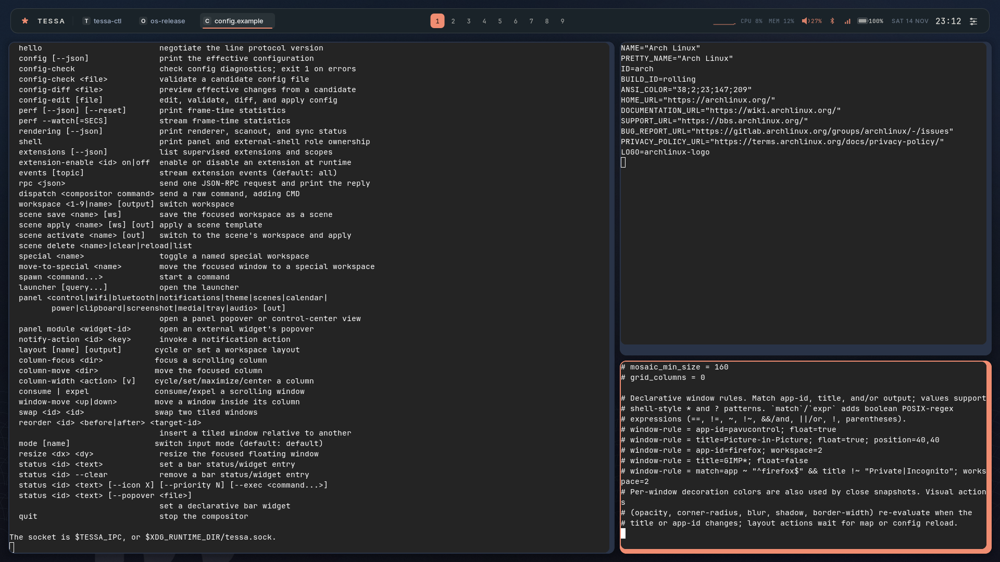
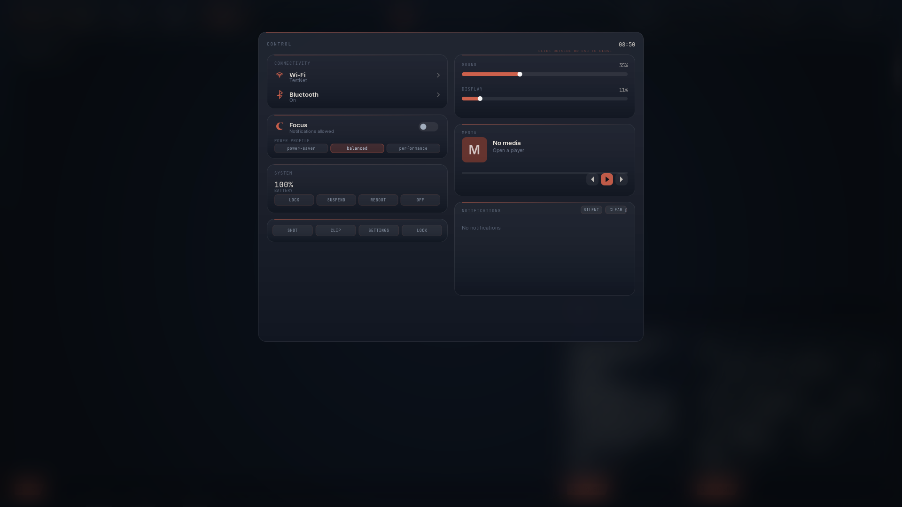
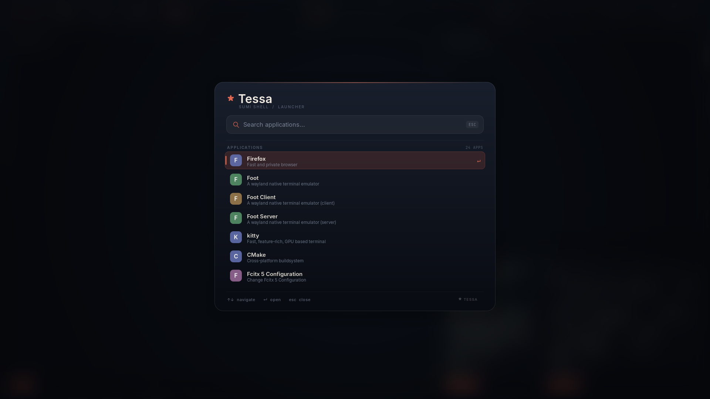
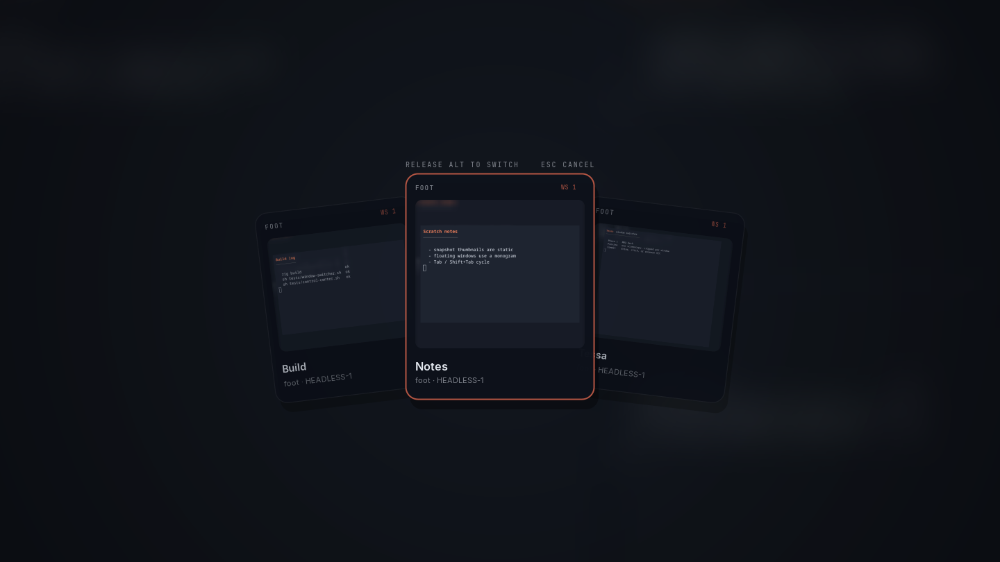
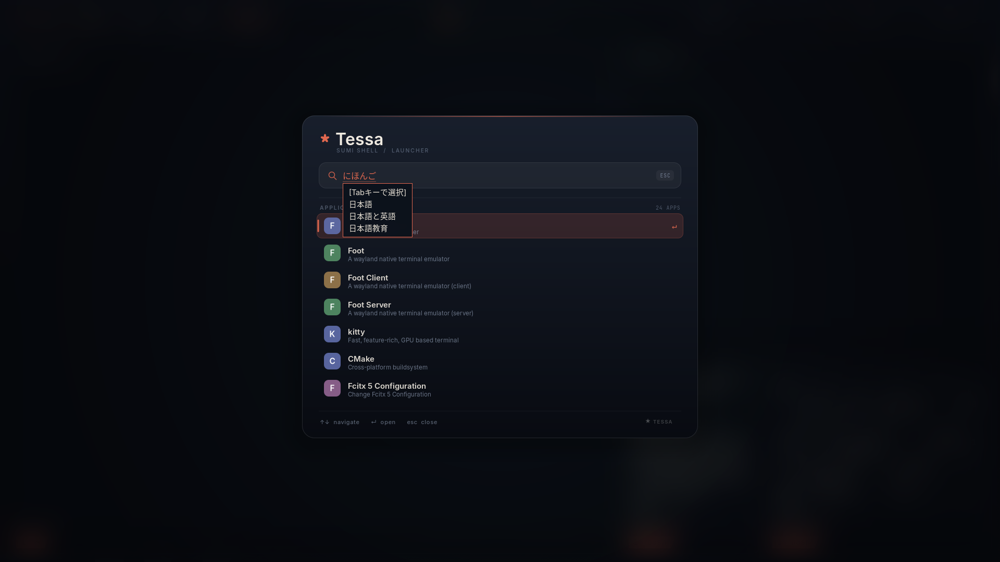
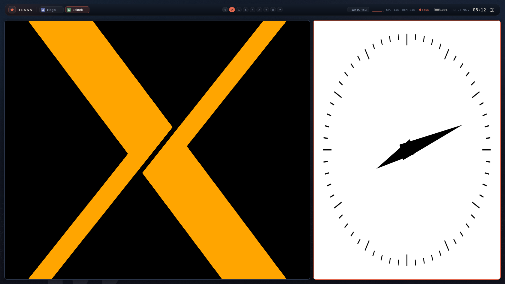
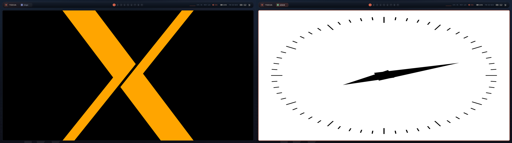
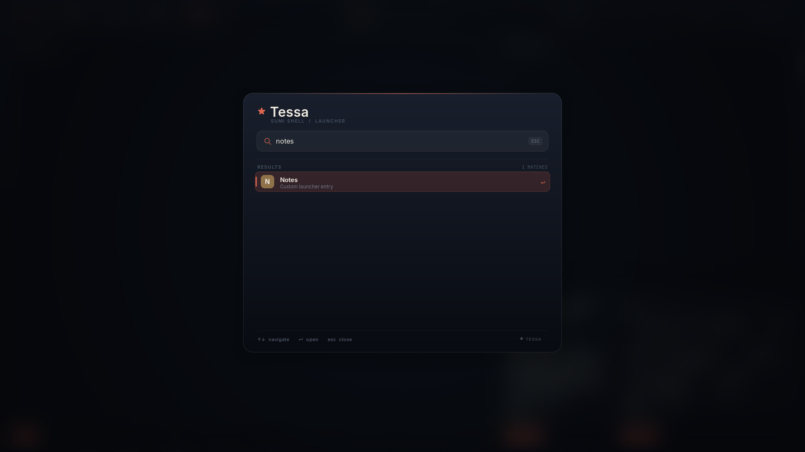

**English** | [日本語](README.ja.md)

<!-- tessa-site-notice:start -->
> [!NOTE]
> This README is also published on the website. For the full documentation and searchable reference, see <https://keychrom.github.io/docs/>.
<!-- tessa-site-notice:end -->

# Tessa

A quiet, tiled Wayland desktop written in Zig on top of wlroots.

Tessa is a compositor **and** a small shell: a floating taskbar, a searchable
launcher, the wallpaper, tiling layouts, workspaces, and the window borders are
all part of this repository. Tessa Panel is the default; Waybar/Rofi/wofi are not
required, but layer-shell-compatible external bars and launchers can replace it.









The screenshots above are from a headless development session using kitty,
foot, and the Vermilion Ink palette. The control center uses demo
NetworkManager and BlueZ services, so no real Wi-Fi SSID or Bluetooth device
is shown.

For a single end-to-end reference covering build, installation, every config
key, rules, effects, IPC, events, and hooks, see the
[complete setup and customization guide](docs/GUIDE.md).

## Install on Ubuntu / Debian

Use the [Ubuntu / Debian installer](https://keychrom.github.io/docs/install-script/).
It installs the current `0.2.5` tree and builds Zig 0.17, wlroots 0.20,
scenefx 0.5, and any missing Wayland libraries under `/opt/tessa` without
replacing the distribution's libraries.

```sh
git clone https://github.com/Keychrom/Tessa.git
cd Tessa
./install.sh --check
./install.sh
```

The default install includes `kitty`, Inter / JetBrains Mono / Noto CJK,
fcitx5 + Mozc, portals, and PipeWire. Use `--minimal` to skip those packages or
`--plain` to build without scenefx effects. The installer is experimental;
read its [testing status](https://keychrom.github.io/docs/install-script/)
before running it.

`xwayland-satellite` is not packaged in Ubuntu or Debian. Install it from
upstream if you need X11 applications, or set `TESSA_XWAYLAND_BIN` to its path.
Log out and select **Tessa** in GDM, SDDM, or another display manager. The
installer provides `/usr/share/wayland-sessions/tessa.desktop` and the
`/usr/local/bin` entry points.

For a quick first test from a TTY:

```sh
tessa
```

Quit with `Super+Shift+E`. Verify the installation with:

```sh
command -v tessa tessa-panel tessa-ctl
tessa-ctl config-check
```

If Tessa was previously installed manually under `/usr/local`, keep only one
installation; the installer replaces the `/usr/local/bin` wrappers and session
entry used by the older install.

## Install on Arch Linux

Tessa requires Zig **0.17**, wlroots **0.20**, and scenefx **0.5**. All are
available in the official repositories as `zig`, `wlroots0.20`, and `scenefx`.
Install the build dependencies:

```sh
sudo pacman -Syu --needed base-devel git zig wlroots0.20 scenefx \
  wayland wayland-protocols libxkbcommon libinput pixman libdrm \
  libegl mesa cairo pango glib2
```

Then build and install Tessa from its PKGBUILD:

```sh
git clone https://github.com/Keychrom/Tessa.git
cd Tessa/packaging/arch
makepkg -si
```

The `tessa-git` package installs the compositor, panel, CLI, session entry,
example config, portal selector, man pages, and documentation under `/usr`.
Verify the result with:

```sh
tessa-ctl config-check
command -v tessa tessa-panel tessa-ctl
```

#### Recommended packages

Install the terminal, output and screenshot tools, screen-sharing portals, and
session utilities:

```sh
sudo pacman -S --needed foot kitty wlr-randr grim swaylock swayidle wlopm \
  dbus xdg-desktop-portal xdg-desktop-portal-wlr pipewire
```

For X11 applications, install `xwayland-satellite-git` from the AUR:

```sh
git clone https://aur.archlinux.org/xwayland-satellite-git.git
cd xwayland-satellite-git
makepkg -si
```

With an AUR helper, the same set is:

```sh
paru -S foot kitty wlr-randr grim swaylock swayidle wlopm dbus \
  xdg-desktop-portal xdg-desktop-portal-wlr pipewire xwayland-satellite-git
```

The PKGBUILD depends on `scenefx` and builds with rounded corners and backdrop
blur by default. For a plain wlroots scene without those effects, build from
source with `-Dscenefx=false`. Log in on a TTY and run `tessa`, or select
**Tessa** in your display manager.

The 0.2.4 Arch package was exercised on Arch Linux with the 0.16/0.19 AUR
toolchain, including a real session and plain/scenefx builds. The 0.2.5
PKGBUILD has been built and installed on Arch Linux with the official `zig`
0.17 and `wlroots0.20` packages, and the full headless suite passes in both
plain and scenefx builds. If `makepkg` reports an ABI or dependency problem,
confirm that `zig version` is `0.17.x` and
`pkg-config --modversion wlroots-0.20` reports `0.20.x`.

`build.zig` forces LLVM/LLD for every build mode, so the glibc 2.43/GCC 16
`R_X86_64_PC64` relocation problem seen with older Zig self-hosted linking
does not require a special optimize mode.

## Status

The current development tree is `0.2.5`; `0.2.4` remains the latest binary
release. Tessa is usable and the core pieces are implemented. The 0.7
customization-parity roadmap items are complete; see
[docs/ROADMAP.md](docs/ROADMAP.md).

Highlights include:

- wlroots 0.20 compositor in Zig (DRM, headless, and nested backends via
  wlroots' autodetection)
- xdg-shell toplevels, layer-shell, data-device and primary-selection
  (clipboard), xdg-activation, xdg-decoration, cursor-shape-v1, and
  wlr-screencopy (grim works)
- master/stack, Tessa "mosaic" spiral, grid, equal-column, Niri-style scrolling,
  monocle, and deck-style stacking layouts, with per-workspace layout profiles
  (`Super+T` cycles); configurable master count, mosaic ratio/size, grid
  columns, column widths/presets, focus centering, and per-workspace
  gaps/master ratio; explicit runtime choices are restored on restart, and
  config reload updates workspaces without a runtime override
- dynamic tiling reorder from IPC (`reorder`, `swap`) or by dragging a tiled
  window with `Super`+left mouse; in scrolling layouts the drag inserts a
  column and `Super`+wheel scrolls the viewport
- declarative window rules matched by app-id/title/output or boolean
  POSIX-regex expressions, with floating, workspace, fullscreen, size,
  position, per-window border colors, opacity, rounding, blur, shadow, tint,
  and border width; layer-shell rules by namespace, output, and layer
- external layout-helper v2 for custom tiling algorithms: one asynchronous
  process per output, coalesced requests, focus/urgent metadata, version
  negotiation, timeout, restart, and built-in fallback
- named special workspaces: hidden per-output overlays assigned by rule or
  command, with toggle/move bindings, IPC control, focus handling, and separate
  visibility from the scratchpad
- long-lived effect-helper protocol v2 that receives window state and returns
  per-window opacity, corner radius, blur/shadow, border-width, tint, and
  animation overrides; requests are coalesced, v1 helpers remain compatible,
  and there is no in-process plugin VM
- supervised extensions declared in config with a stable v1 API, capability
  scopes, rotating tokens, and `requires`/`after` dependencies; pidfd
  supervision, ready timeout, restart backoff, lifecycle events,
  `tessa-ctl extensions`, and an Extensions popover
- selectable panel modules (`panel_modules`) so an external Waybar/Quickshell
  bar can coexist with Tessa notifications, launcher, or popovers
- composable shell v2 bar modules with configurable order and visibility,
  per-surface bar/launcher/popover/toast fonts and foreground/background
  colors, PNG or PPM-shader wallpaper sources, and layer-rule styling for the
  bar, popovers, and toasts
- compositor-context bar modules (`layout`, `groups`, `mode`, `effects`), a
  module registry via `tessa-panel --list-modules`, theme-token export via
  `tessa-panel --theme-json`, directory theme packages with hot reload,
  declarative status widgets with icon/priority and file-backed popovers,
  priority-based bar overflow with a `+N` hidden-module list, and shell role
  ownership via `tessa-ctl shell`
- frame-time instrumentation (`tessa-ctl perf`) with a configurable
  `frame_time_budget`, plus headless animation and full-effect benchmarks
- direct scanout for full-output fullscreen clients, with scanout/zero-copy/
  tearing counters in `tessa-ctl rendering` and presented/vsync/missed plus
  frame timings in `tessa-ctl perf`; opt-in `wp-tearing-control-v1` with a
  driver test and normal-flip fallback, and gated `linux-drm-syncobj-v1`
  explicit sync. HDR color management is investigated but not advertised yet;
  see [docs/RENDERING.md](docs/RENDERING.md)
- interactive config editing with validation and effective-config diff preview
  (`tessa-ctl config-check <file>`, `config-diff <file>`, `config-edit`) and
  offline preflight with `tessa --check-config [file]`
- supervised built-in panel: pidfd-based exit detection with bounded exponential
  backoff, so a panel crash does not take down the bar for the session
- fuzzing and sanitizer boundary passes for the config and IPC parsers
  (`tests/fuzz-parsers.sh`, `tests/fuzz-asan.sh`), plus strict helper-timeout
  regression coverage
- file/line config diagnostics, automatic reload on atomic config saves,
  transactional reload, and versioned JSON state/config snapshots for external
  tools; per-workspace and per-output layout/gap/master rules; animation
  lifecycle hooks
- named layout profiles shared by output and workspace rules, plus per-output
  theme rules for backgrounds, borders, wallpaper, and panel dimensions
- per-device libinput policy for touchpads, mice, and other pointers: tap and
  drag, natural scrolling, acceleration, scroll/click methods, button maps,
  and disable-while-typing, with live reload and original-state restoration;
  monitor rules matched by connector, EDID make/model/serial, or both, plus
  VRR/adaptive-sync policy and cursor theme/size
- config-defined event rules with expression filtering and command actions
- named input modes with mode-specific key bindings, leader keys, `enter-mode`,
  and per-mode timeouts
- semantic theme roles for accent, borders, wallpaper, and the panel
- configurable bar height, top/side margins, and bar background/foreground colors
- window open/workspace slide animations with per-kind durations, named
  cubic-bezier and spring curves, per-window enable/duration/curve overrides,
  configurable offsets, close scale/fade snapshots, reduced-motion close
  fades, and soft layered shadows; scenefx rounded corners and backdrop blur
  for windows and shell surfaces by default; configurable
  wallpaper gradient colors, a PNG wallpaper source with cover/contain/stretch
  fit, and an art on/off switch
- nine workspaces per output, floating windows, fullscreen, click-to-focus;
  optional global workspace names for bar labels, bindings, IPC, and window
  rules; a per-output floating scratchpad overlay and tabbed workspace window
  groups
- multi-monitor support: a bar/background and independent active workspace on
  every output; panels are auto-started per output; workspace-to-output pins;
  output management via `wlr-randr`, persisted across restarts; fractional
  Wayland scaling through `wp_fractional_scale_v1` and integer HiDPI panel
  buffer scaling
- external extension API: line events, JSON-RPC with request ids and
  capabilities, JSON event notifications, config hooks and event rules, custom
  bar status entries, custom launcher entries, and the `tessa-ctl` automation
  client
- `relative-pointer-v1` for games and pointer-look applications
- `wlr-virtual-pointer-v1` for scripted pointer automation and headless tests
- `pointer-constraints-v1` locked/confined pointers, activated with window focus
- touchpad gestures: three-finger (configurable) horizontal workspace swipes and
  upward launcher swipes; other finger counts and pinch/hold gestures are
  forwarded to the focused client
- touch input, including the panel UI, and tablet-v2 pen/pad support (pressure,
  tilt, rotation, tool buttons, rings, and strips)
- layer-shell popups from third-party clients (panel menus, dropdowns)
- external layer-shell shells: Waybar, Wofi, and Quickshell-compatible bars and
  launchers, `ext-workspace-v1` groups with nine workspaces per output,
  foreign-toplevel output tracking, and `ON_DEMAND` click focus
- `ext-session-lock-v1` session locking, plus `ext-idle-notify-v1`,
  `idle-inhibit-v1`, and output-power management for tools such as swayidle and
  wlopm
- keyboard layout/variant/options and key-repeat settings in the config, with
  `Super+R` reload
- text-input-v3 + input-method-v2 IME relay with input-popup placement;
  verified end to end with Fcitx5 + Mozc in the launcher and Wayland clients
- XWayland through `xwayland-satellite`: rootless X11 apps are managed as normal
  Tessa toplevels, and `DISPLAY` is exported to spawned applications
- XIM integration: `XMODIFIERS` is exported for X11 clients and an optional
  `xim_start` command launches the input method after the X display appears
- integrated panel in Zig + Cairo/Pango:
  - ink/sun wallpaper
  - floating taskbar with workspace pills, window chips, clock, CPU/RAM
  - searchable application launcher with keyboard navigation and IME input
  - clock popover with a month calendar and a power menu with configurable
    lock/suspend/reboot/shutdown commands
  - memory-only clipboard history with `Super+V` and click-to-copy
  - region/full-output screenshot UI using `wlr-screencopy`, saved as PNG
  - `org.freedesktop.Notifications` service with action buttons, default-action
    activation, image/data icons, Pango markup, replacement, close, expiry, and
    routing to the focused output
  - battery and default-route network indicators
  - classic or unified control center (`panel_style`): unified mode adds a
    dedicated Controls button and one panel with home, Wi-Fi, Bluetooth,
    notifications, calendar, tray, and power views; classic mode keeps the
    separate popovers and adds Wi-Fi/Bluetooth ones
  - NetworkManager Wi-Fi: scan, signal strength, WPA2/WPA3-PSK and open
    networks, hidden SSIDs, saved connections, connect/disconnect/forget, and
    radio power
  - BlueZ Bluetooth: adapter power, discovery, pairing agent prompts, connect/
    disconnect/forget, and device battery level
  - notification history (50 entries), Focus/DND toast suppression, clear, and
    notification actions
  - brightness (logind) and power-profile (power-profiles-daemon) controls;
    `control_features` gates each control-center feature independently
  - MRU window switcher (`Alt+Tab`, `Alt+Shift+Tab`) across all outputs and
    workspaces: live GPU-rendered per-window previews capped at 512 px, blurred
    per-card backdrops, switching to the selected output/workspace, icon-only
    mode, and `Esc`/click/Alt-release commit; `window_switcher =
    snapshot|icons|off`
  - bar placement on any edge (`bar_position = top|bottom|left|right`), with
    vertical layouts for the bar and control center
  - MPRIS media chip and controls (`Super+M`), local album artwork, progress,
    and click-to-seek
  - StatusNotifier tray watcher/host with icon rendering and activation
    (`Super+Shift+T`)
  - volume indicator and popover through `wpctl`, `pactl`, or `amixer`
    (`Super+Shift+A`), with configurable command overrides and an absolute
    control-center slider
  - compositor-side xdg-desktop-portal support: screencopy, dmabuf, output
    capture sources, image-copy capture, and foreign-toplevel lists for
    `xdg-desktop-portal-wlr` + PipeWire screen sharing
- line-based IPC with explicit state/event subscriptions and a `tessa-ctl` CLI
- line-based configuration file with includes and event hooks

Tessa 0.2.4 was built and tested on Ubuntu 26.04 and Arch Linux with Zig 0.16.0
and wlroots 0.19.2, primarily in the headless pixman backend with `grim`,
`wtype`, Fcitx5 + Mozc, and X11 clients through `xwayland-satellite`; the Arch
host also runs the compositor in a real session for display, keyboard, mouse,
IME, and browser checks. Dual-headless-output
workspaces, per-output panels, session locking across outputs, and `wlr-randr`
output management were also verified. Event hooks, the event stream, custom
status entries, custom launcher entries, config reload, per-workspace
master/mosaic/grid/columns layouts, 2x HiDPI panel scaling, fractional output
scale changes, and output mode/position/scale and layout persistence across
restarts were exercised by
`tests/smoke.sh`, `tests/output-persistence.sh`, `tests/layout-geometry.sh`,
`tests/customization.sh`, `tests/layout-helper.sh`, `tests/layout-helper-v2.sh`,
`tests/config-validation.sh`,
`tests/config-watch.sh`, `tests/json-ipc.sh`, `tests/modes.sh`,
`tests/panel-theme.sh`, `tests/panel-fonts.sh`, `tests/bar-position.sh`,
`tests/panel-popovers.sh`, `tests/control-center.sh`,
`tests/window-switcher.sh`, `tests/panel-compat.sh`, `tests/wifi.sh`,
`tests/bluetooth.sh`, `tests/brightness.sh`, `tests/clipboard.sh`,
`tests/screenshot.sh`,
`tests/notifications.sh`, `tests/notification-routing.sh`,
`tests/system-status.sh`, `tests/media.sh`, `tests/media-art.sh`, `tests/tray.sh`,
`tests/audio.sh`,
`tests/foreign-toplevels.sh`, `tests/animations.sh`, `tests/motion.sh`,
`tests/motion-overrides.sh`, `tests/effects.sh`, `tests/rule-visuals.sh`,
`tests/window-shader.sh`, `tests/input.sh`, `tests/ime-keyboard.sh`,
`tests/ext-workspace.sh`, `tests/external-shell.sh`,
`tests/pointer-constraints.sh`, `tests/xim.sh`,
`tests/fractional-scale.sh`, `tests/cursor-theme.sh`,
`tests/linux-dmabuf.sh`, `tests/spawn-signals.sh`,
`tests/xwayland-ready.sh`, `tests/kitty-startup.sh`,
`tests/xwayland-kitty.sh`, `tests/workspace-pinning.sh`,
`tests/output-rules.sh`, `tests/rule-expressions.sh`, `tests/event-rules.sh`,
`tests/output-themes.sh`, `tests/theme-roles.sh`, `tests/reduced-motion.sh`,
`tests/profiles.sh`, `tests/json-rpc.sh`, `tests/interaction.sh`,
`tests/popups.sh`, `tests/portal.sh`, `tests/special-workspaces.sh`,
`tests/scratchpad.sh`, `tests/window-groups.sh`, `tests/workspace-names.sh`,
`tests/wallpaper-image.sh`, `tests/terminal-fallback.sh`,
`tests/shell-v2.sh`, `tests/effect-helper.sh`, `tests/performance.sh`,
`tests/rendering.sh`, `tests/tearing.sh`,
`tests/config-editor.sh`, `tests/panel-recovery.sh`, `tests/ipc-version.sh`,
`tests/helper-timeouts.sh`, `tests/fuzz-parsers.sh`, and
`tests/fuzz-asan.sh`.
The 0.2.5 source tree targets Zig 0.17.0, wlroots 0.20.2, and scenefx 0.5. The
full headless suite passes on Arch Linux against those libraries in
both plain and scenefx builds, including end-to-end portal ScreenCast, tray,
notifications, pointer interaction, and scenefx corner rendering. The 0.2.5
tree additionally passes `tests/layout-scrolling.sh`, `tests/layout-modes.sh`,
`tests/layout-reorder.sh`, `tests/layout-config.sh`, `tests/extensions.sh`,
`tests/extension-api.sh`, `tests/panel-modules.sh`, `tests/effect-v2.sh`,
`tests/effect-cache.sh`, `tests/control-center.sh`,
`tests/window-switcher.sh`, `tests/wifi.sh`, `tests/bluetooth.sh`,
`tests/brightness.sh`, and `tests/media-art.sh`.
The Wi-Fi, Bluetooth, brightness, and power-profile tests use a private system
bus with fake NetworkManager, BlueZ, logind, and power-profiles-daemon
services; they do not touch the real session's network or devices.
A real DRM/libinput session on the new toolchain is still pending.

The portal test performs an end-to-end ScreenCast when the portal and PipeWire
services are installed; otherwise it skips. `tests/effects.sh` exercises rounded
corners in scenefx builds (the default) and skips when the binary was built with
`-Dscenefx=false`. The Kitty and real
XWayland integration tests skip when Kitty, `wlr-randr`, or
`xwayland-satellite` is unavailable; `tests/xwayland-ready.sh` uses a fake
satellite so DISPLAY readiness is covered everywhere.
Physical Arch Linux validation covers an eDP-1 DRM session, keyboard/mouse,
IME, and XWayland clients; per-device touchpad tuning and VRR remain tracked in
[Known limitations](#known-limitations).

## Why another tiling WM?

Tessa's goal is not to out-feature Hyprland. It is a different, more compact
desktop:

- **Integrated shell.** The bar, launcher, wallpaper, and tiling live together.
  The palette and behavior are consistent because they are one project.
- **A different layout.** Besides master/stack, Tessa has a spiral "tessera"
  mosaic layout, a balanced grid, equal columns, a Niri-style scrolling strip,
  monocle, and deck-style stacking (`Super+T` cycles the configured list).
  Tiled windows can be reordered by dragging them or from the IPC.
  The name Tessa comes from tessellation.
- **Sumi-e visual language.** Indigo paper, ink washes, a vermilion sun, grain,
  and a floating glass-like bar. The panel is not a generic status bar with a
  theme on top.
- **Small, direct implementation.** Zig + wlroots, a line config, a line IPC
  protocol, and small C shims for Pango, GDBus, and mixer commands.
- **Reliability-first.** Configs can be validated offline before restart,
  reloads are transactional, helper processes have strict 100/200 ms fallback
  contracts, and the built-in panel is supervised. Fuzz and ASan passes cover
  the config and IPC parsers.
- **No JavaScript/TypeScript runtime.** Unlike ShojiWM, the shell and config are
  fixed and small. If you want to program every pixel in TSX, ShojiWM is the
  better tool. If you want animations, blur, and a huge plugin ecosystem,
  Hyprland is the better tool. Tessa sits in the "quiet, integrated, hackable
  Zig compositor" niche.

The terminal is intentionally not implemented from scratch. The default
terminal is **kitty**; set `terminal = foot` if you prefer foot.

## Build from source (development)

Use this path for development, unsupported distributions, or a plain
no-scenefx build. The Ubuntu/Debian installer and Arch `tessa-git` package
above are sufficient
for normal use on their respective distributions.

Requirements:

- Zig **0.17.0**
- wlroots **0.20** development files, discoverable with
  `pkg-config --modversion wlroots-0.20`
- [scenefx](https://github.com/wlrfx/scenefx) **0.5** development files for the
  default rounded corners and backdrop blur build
  (`pkg-config --modversion scenefx-0.5`)
- Wayland, xkbcommon, pixman, libdrm, libinput, seat/udev, EGL/GLES,
  and wayland-protocols >= 1.47 (for the generated enum headers)
- Cairo, Pango, GLib/GIO, and gdk-pixbuf development files for the panel,
  notifications, and MPRIS artwork
- fonts: Inter, JetBrains Mono, and a CJK font such as Noto Sans CJK JP
- optional: [`xwayland-satellite`](https://github.com/Supreeeme/xwayland-satellite)
  for X11 applications (auto-started when `xwayland = true`)
- optional: Fcitx5 + Mozc (or another input method that implements
  `zwp_input_method_v2`) for Japanese input
- optional: `wlr-randr` for runtime output mode/position/scale changes
- optional: a D-Bus session bus for desktop notifications, tray, and portals
- optional: `wpctl` (PipeWire), `pactl` (PulseAudio), or `amixer` (ALSA) for
  volume control
- optional: `xdg-desktop-portal`, `xdg-desktop-portal-wlr`, and PipeWire for
  screen sharing (install `packaging/portal/tessa.portal` as described below)

Distribution packaging definitions live in `packaging/` and `debian/`:
`packaging/arch/PKGBUILD` and the debhelper `debian/` tree both install the
compositor, panel, CLI, session file, example config, and the
`xdg-desktop-portal` backend selector. To build a Debian binary package:

```sh
ZIG="$HOME/.local/zig-0.17.0/zig" ./scripts/build-deb.sh
# result: dist/tessa_<version>_<arch>.deb
```

The `.deb` path is retained for downstream packaging, but 0.2.4 remains the
last published Debian package; `debian/control` now expects
the wlroots 0.20 development files; Ubuntu 26.04 does not provide them, so
normal installs should use the installer above.

See [packaging/README.md](packaging/README.md).

For screen sharing, install `xdg-desktop-portal`, `xdg-desktop-portal-wlr`, and
PipeWire. The packaged selector is
`packaging/portal/tessa.portal`; a system install places it at
`/usr/share/xdg-desktop-portal/portals/tessa.portal`. It routes the Screenshot
and ScreenCast portals to the wlr backend for `XDG_CURRENT_DESKTOP=Tessa`.
xdpw needs a source chooser; for a single monitor set
`chooser_type=none` and `output_name=<output>` in
`~/.config/xdg-desktop-portal-wlr/config`.

Portal services are D-Bus activated from the systemd user manager, which does
not know the Wayland display on its own. `tessa-session` publishes
`WAYLAND_DISPLAY`, `XDG_CURRENT_DESKTOP`, `XDG_SESSION_TYPE`, and
`XDG_SESSION_DESKTOP` there once the compositor socket exists, and restarts a
portal that resolved its backends before the import. When starting `tessa` by
hand, run the same import:

```sh
systemctl --user import-environment WAYLAND_DISPLAY XDG_CURRENT_DESKTOP \
  XDG_SESSION_TYPE XDG_SESSION_DESKTOP
systemctl --user restart xdg-desktop-portal
```

With no `chooser_type` set, xdpw runs the first chooser it finds (`slurp`,
`wmenu`, `wofi`, `rofi`, `bemenu`, `mew`, or `fuzzel`) and falls back to an
arbitrary output. Discord, Chromium-based browsers, and OBS share their screen
through this portal.

On Ubuntu 26.04, install Zig 0.17 from upstream if the distribution package is
older, then the development headers:

```sh
sudo apt install build-essential pkg-config git \
  libwayland-dev wayland-protocols \
  libxkbcommon-dev libpixman-1-dev libdrm-dev libinput-dev \
  libseat-dev libudev-dev libegl-dev libgles2-mesa-dev \
  libcairo2-dev libpango1.0-dev libglib2.0-dev libfontconfig1-dev \
  fonts-inter fonts-jetbrains-mono fonts-noto-cjk \
  xwayland xauth xterm fcitx5 fcitx5-mozc
```

Ubuntu 26.04 packages wlroots 0.19, not 0.20. The installer above builds
wlroots 0.20 and scenefx 0.5 under `/opt/tessa`; use it for a complete
toolchain.

For a manual source build, build scenefx 0.5 from source for the default
effects, or pass `-Dscenefx=false` for the plain wlroots scene.

On Arch Linux, install the official `zig`, `wlroots0.20`, and `scenefx` packages
as described in [Install on Arch Linux](#install-on-arch-linux). The default
build uses `scenefx` 0.5; use `-Dscenefx=false` to build the plain wlroots
scene instead. `scripts/build.sh` requires Zig 0.17.x; `ZIG=/path/to/zig`
overrides the compiler. Do not use Zig 0.16 or wlroots 0.19 for this tree.

`xwayland-satellite` is not packaged everywhere; install it into `PATH` (for
example `~/.local/bin/xwayland-satellite`), or set `TESSA_XWAYLAND_BIN` to its
absolute path. Tessa does not use wlroots' built-in XWayland; satellite gives
rootless X11 windows to the compositor as ordinary xdg-shell toplevels.

If wlroots 0.20 is installed under `/usr/local` (for example when built from source),
make sure its `.pc` file and shared library are found:

```sh
pkg-config --modversion wlroots-0.20
ldconfig -p | grep wlroots
```

Build:

```sh
chmod +x scripts/*.sh scripts/tessa-session   # once, if not preserved
./scripts/build.sh -Doptimize=ReleaseSafe
```

Rounded corners and backdrop blur are enabled by default. Install scenefx 0.5
(the wlroots 0.20 series), then build normally:

```sh
./scripts/build.sh -Doptimize=ReleaseSafe
```

This switches the scene and renderer to scenefx's GLES2 path;
`WLR_RENDERER=pixman` is not available in that binary. For a plain build that
keeps the upstream wlroots scene and supports both GL and software rendering,
disable scenefx explicitly:

```sh
./scripts/build.sh -Doptimize=ReleaseSafe -Dscenefx=false
```

If scenefx is installed under a non-system prefix, export its pkg-config and
library paths when building and running.

`tessa-panel` is built and installed by default, together with its Cairo,
Pango, GdkPixbuf, and GIO dependencies. For a compositor-only build that omits
the panel entirely, pass:

```sh
./scripts/build.sh -Doptimize=ReleaseSafe -Dpanel=false
```

The resulting `tessa` still works with external layer-shell bars and launchers,
but the built-in panel, launcher, notifications, tray, and wallpaper are not
included; `panel = true` in the config is ignored. `tessa-ctl` is still built.

To build only one side, use the named steps:

```sh
./scripts/build.sh panel       # tessa-panel only
./scripts/build.sh compositor  # tessa only
```

The panel still expects Tessa's IPC socket at runtime; a panel-only build is
intended for packaging and for future compatibility adapters. This default
install still includes all three binaries.

This produces:

- `zig-out/bin/tessa` — the compositor
- `zig-out/bin/tessa-panel` — the shell panel (one process per output, auto-started by tessa; omitted with `-Dpanel=false`)
- `zig-out/bin/tessa-ctl` — state/event/automation client for scripts and extensions

The generated Wayland protocol headers are committed under `protocol/`, so a
wlroots installation without generated `xdg-shell-protocol.h` still builds.

## Run

### Tessa Panel on Hyprland or Niri (experimental)

`tessa-panel` can run outside Tessa through `tessa-panel-compat`, a Python 3
compatibility bridge that translates Hyprland/Niri IPC into the panel's Tessa
IPC protocol. Build the panel and start the bridge inside the session:

```sh
./scripts/build.sh panel
python3 tools/tessa-panel-compat.py
```

A packaged install provides `tessa-panel-compat` in `PATH`. The bridge starts
one panel per output and listens on `$XDG_RUNTIME_DIR/tessa.sock`.

Hyprland key bindings:

```ini
bind = SUPER, Space, exec, tessa-panel-compat --send launcher
bind = ALT, Tab, exec, tessa-panel-compat --send switcher
bind = ALT SHIFT, Tab, exec, tessa-panel-compat --send switcher-prev
```

For Niri, spawn `tessa-panel-compat --send launcher` and the same
`--send switcher` targets from `binds`. When running directly from a source
checkout, replace `tessa-panel-compat` with
`python3 tools/tessa-panel-compat.py`.

The bar maps workspaces 1–9. Special/named workspaces and Tessa extensions are
not translated yet. Window switcher previews fall back to screencopy or
monograms, and blur/rounding come from the host compositor. Disable other
notification and tray daemons before starting the bridge. See
[the guide](docs/GUIDE.md#panel-build) for details and troubleshooting.

### From a TTY (recommended first test)

Log in on the target machine's console, not over SSH, and run from the active
virtual terminal. For a package install:

```sh
tessa
```

For a source build:

```sh
cd /path/to/Tessa
PATH="$PWD/zig-out/bin:$PATH" ./zig-out/bin/tessa
```

wlroots autodetects the DRM backend and libinput. Tessa starts one
`tessa-panel` process per output from `PATH`, so include `zig-out/bin` or
install the binaries. The default terminal is `kitty`; install it, or set
`terminal = foot` in the config.

### Display manager / session file

The Ubuntu/Debian installer and Arch package already install the session entry.
Use this only when
running from a source build:

```sh
# install to ~/.local
./scripts/install-session.sh

# or system-wide
sudo PREFIX=/usr/local ./scripts/install-session.sh
```

Then log out and choose **Tessa** in GDM/SDDM/greetd. The session file runs
`tessa-session`, which puts its own directory at the front of `PATH` and starts
`tessa`.

### Headless development over SSH

This is the headless workflow used during development. Start the compositor:

```sh
./scripts/run-headless.sh
```

In another shell, take a screenshot:

```sh
./scripts/screenshot.sh /tmp/tessa.png
```

Because the headless backend starts without physical input devices, Tessa
creates a fallback keyboard with a standard XKB keymap. This lets the panel,
IME, and XWayland start correctly. Use IPC for mouse/state changes, or inject
keyboard input with `wtype`:

```sh
XDG_RUNTIME_DIR=/tmp/tessa-headless WAYLAND_DISPLAY=wayland-0 \
  wtype "foot"
XDG_RUNTIME_DIR=/tmp/tessa-headless WAYLAND_DISPLAY=wayland-0 \
  wtype -k Return
```

`wtype` connects through the virtual-keyboard protocol; it types into whichever
surface currently has keyboard focus. This is also how the IME and panel
keyboard paths are tested without a TTY.

See [docs/DEVELOPMENT.md](docs/DEVELOPMENT.md) for the headless workflow and
[docs/EXTENDING.md](docs/EXTENDING.md) for scripting and extension APIs. The
stable v1 contract is [docs/EXTENSION-API.md](docs/EXTENSION-API.md).

## Input methods



Tessa implements the `zwp_text_input_v3` (client) and
`zwp_input_method_v2` (input method) protocols and relays focus, surrounding
text, cursor rectangles, preedit, committed text, and deletion. Input-method
popup surfaces (the candidate window) are positioned below the text cursor with
output-edge clamping.

Tested with **Fcitx5 + Mozc**:

```sh
sudo apt install fcitx5 fcitx5-mozc
```

Start Fcitx5 inside the Tessa session (for example through `TESSA_STARTUP` or
your compositor's spawn command). You do not need to set `GTK_IM_MODULE` or
`QT_IM_MODULE` for Wayland-native clients: they use the Wayland text-input
protocol. For X11 clients, Tessa exports `XMODIFIERS=@im=fcitx` (adjust
`xim_server`) and can start the XIM server itself with
`xim_start = fcitx5 -d`. The server is started only after the XWayland display
exists. Registration is verified with Fcitx5; toolkit-specific XIM behavior
still depends on the application.

Fcitx5 keeps a keyboard grab while it runs. Tessa forwards key events to that
grab and passes the input method's virtual-keyboard output back to the focused
client, so applications that do not use `text-input-v3` (for example Firefox)
still receive keys. Creating or destroying that virtual keyboard does not
re-enter keyboard focus, which avoids a text-input enable/activate loop.

Open the launcher with `Super+D` and type; the preedit is drawn in the search
field and the Fcitx candidate popup appears below it. `Enter` commits the
selection, and the committed text becomes part of the launcher query.

## X11 applications



Tessa starts `xwayland-satellite` after the Wayland socket is ready and exports
the chosen display as `DISPLAY`. X11 applications are rootless: each X11
toplevel appears as a normal Tessa window and participates in tiling,
workspaces, focus, and the taskbar. Tessa advertises `xdg-decoration` in
server-side mode, so satellite does not draw its own titlebars; Tessa's accent
border is used instead.

The display is chosen automatically by default (`xwayland_display = auto`),
starting at `:0` and skipping displays whose sockets already exist. Set it to an
explicit value such as `:1` if needed. Disable XWayland with `xwayland = false`
or `TESSA_NO_XWAYLAND=1`. If satellite is installed outside `PATH`, set
`TESSA_XWAYLAND_BIN=/path/to/xwayland-satellite`.

XWayland scaling is delegated to `xwayland-satellite`. Tessa advertises
`wp_fractional_scale_v1` and `wp_viewporter`, so satellite can scale X11 clients
to fractional output scales; toolkits that ignore XSETTINGS may still render at
1x. Fractional X11 behavior needs validation on a machine with satellite
installed.

## Lock and idle

Tessa implements `ext-session-lock-v1`, `ext-idle-notify-v1`, and
`idle-inhibit-v1`. A lock client and an idle daemon are separate programs:

```sh
sudo apt install swaylock swayidle
```

`Super+Escape` runs `swaylock` by default. If you prefer another locker, change
that binding with `bind = SUPER+Escape spawn <command>`. While locked, normal
desktop scene trees are hidden, virtual-keyboard injection is ignored, and the
lock surface receives keyboard/pointer focus. If the lock client dies while
locked, Tessa terminates the session instead of exposing the desktop.

`swayidle` can combine idle detection with locking and DPMS, for example:

```sh
sudo apt install wlopm
swayidle -w \
  timeout 300 'swaylock -f' \
  timeout 600 'wlopm --off "*"' \
  resume 'wlopm --on "*"'
```

Idle notifications and inhibitor handling work, and a visible video/player can
inhibit idle through `idle-inhibit-v1`. Tessa implements the output-power
management protocol, so `wlopm` can turn outputs off and back on.

## Multiple monitors



Every output gets its own background, bar, and independent active workspace.
`Super+1` … `Super+9` change the workspace of the focused output. Clicking or
scrolling a bar changes that monitor's workspace and focuses that output.
`workspace_pin = OUTPUT WORKSPACE` overrides that target, so the shortcut and
bar always bring the pinned monitor forward; moving a window to a pinned
workspace transfers it to that output.
The launcher opens on the focused output, and new windows are placed there.
`Super+Shift+H/J/K/L` swaps within the current output first; when there is no
window in that direction it moves the focused window to the adjacent monitor.

Tessa auto-starts one `tessa-panel` process per output with
`TESSA_PANEL_OUTPUT=<name>`. If you disable auto-start (`panel = false` or
`TESSA_NO_PANEL=1`), start a panel for each output manually:

```sh
TESSA_PANEL_OUTPUT=HEADLESS-1 tessa-panel
```

Output modes, positions, scales, and transforms can be changed with `wlr-randr`;
Tessa implements `wlr-output-management-unstable-v1`. Applied settings are
saved to `$XDG_CONFIG_HOME/tessa/outputs.conf` (or
`~/.config/tessa/outputs.conf`) and restored when the outputs appear again.
Override the path with `output_config` in the main config or
`TESSA_OUTPUT_CONFIG`. For an explicit left/center arrangement, set positions
in logical layout coordinates (use the connector names printed by
`wlr-randr`):

```sh
wlr-randr --output DP-1 --pos 0,0
wlr-randr --output HDMI-A-1 --pos 2560,0
```

The change is saved immediately. Fractional-scale-aware Wayland clients receive
the exact output scale from `wp_fractional_scale_v1`, including runtime changes.
Clients without the protocol fall back to the ceiling of the output scale.
Panels use the ceiling as their integer Cairo buffer scale, so integer scales
are crisp and fractional scales are downsampled. XWayland scaling is handled by
`xwayland-satellite`, which can use the same fractional scale.

## External bars and launchers

Tessa Panel remains the default shell (`panel = true`). To use a layer-shell bar
or launcher from another desktop, disable the integrated panel and start the
program from `startup`:

```ini
panel = false
startup = waybar
```

`panel = false` also disables Tessa's background, notifications, and built-in
launcher; run your own wallpaper and notification daemon if needed.

Waybar 0.15 works with the standard layer-shell and `ext-workspace-v1`
protocols. For example:

```jsonc
{
  "layer": "top",
  "position": "top",
  "height": 34,
  "modules-left": ["ext/workspaces"],
  "modules-center": ["wlr/taskbar"]
}
```

Tessa exposes one workspace group per output and nine workspaces in each group.
Workspaces carry their configured name (or `1`…`9`), active/urgent state, and an
activate request. `wlr-foreign-toplevel-management` supplies the taskbar with
title, app_id, activation, close, and fullscreen, and follows windows when they
move between outputs.

Wofi and other layer-shell launchers work without extra configuration. To
replace the built-in launcher binding:

```ini
bind = SUPER+D spawn wofi --show drun
```

Set Wofi's layer to `overlay` if it should stay above fullscreen windows.

Quickshell panels use layer-shell; `Quickshell.WindowManager` reads the
ext-workspace groups and `ToplevelManager` reads foreign-toplevel. A
`PanelWindow` with `focusable: true` requests `ON_DEMAND` keyboard focus and
receives it on click rather than at map time.

Coexistence notes:
- Tessa Panel and an external bar anchored to the same edge both reserve space.
  Disable one with `panel = false` for a single bar; different edges can coexist.
- Tessa Panel's tray, Waybar's tray, and Quickshell's `SystemTray` all try to own
  `org.kde.StatusNotifierWatcher`. Only one tray is populated; disable Tessa
  Panel when the external shell should own the tray.
- Waybar's minimize/maximize requests are accepted by the protocol but are
  no-ops because Tessa has no minimize/maximize state.
- GTK3 bars and launchers render at integer scale under fractional scaling; this
  is a client limitation.

## Extensions



Tessa does not embed a plugin VM. Extensions are normal processes that speak the
compositor's Unix-socket API; they can be written in any language. `tessa-ctl`
exposes state snapshots, structured events, status entries, and commands:

```sh
tessa-ctl state
tessa-ctl state --json
tessa-ctl config
tessa-ctl config --json
tessa-ctl config-check
tessa-ctl events window-focus
tessa-ctl status weather "Tokyo 18C"
tessa-ctl dispatch reload
```

`state --json` and `config --json` return schema-versioned snapshots for tools.
`config-check` prints file/line diagnostics and exits non-zero while the loaded
configuration has errors. Configuration can also start commands at login and
react to compositor events:

```ini
startup = fcitx5 -d
hook = window-open notify-send "Window opened" "$TESSA_TITLE"
hook = animation-done echo "$TESSA_ARG $TESSA_WINDOW_ID" >> ~/.cache/tessa-animations.log
hook = close-animation-done echo "closed $TESSA_WINDOW_ID" >> ~/.cache/tessa-animations.log
launcher_entry = Notes | foot -e nvim ~/notes.md
include = /home/you/.config/tessa/launcher-entries.conf
```

The panel displays up to eight extension status entries and can run a command
when one is clicked. See [docs/EXTENDING.md](docs/EXTENDING.md) for the complete
event schema, hook environment, and status API.

## Key bindings

| Binding | Action |
| --- | --- |
| `Super+Return` | terminal (`terminal` config value) |
| `Super+D` | launcher |
| `Super+V` | clipboard history |
| `Super+Shift+S` | screenshot region/full output |
| `Super+M` | MPRIS media controls |
| `Super+Shift+T` | StatusNotifier tray |
| `Super+Shift+A` | volume controls |
| `Super+T` | cycle through `layout_cycle` (master → mosaic → grid → columns by default) |
| `Super+Q` | close focused window |
| `Super+Shift+E` | quit Tessa |
| `Super+R` | reload config |
| `Super+1` … `Super+9` | switch workspace |
| `Super+Shift+1` … `Super+Shift+9` | move window to workspace |
| `Super+H/J/K/L` | focus left/down/up/right |
| `Super+left-drag` | reorder a tiled window (inserts a column in scrolling layouts) |
| `Super+wheel` | scroll the viewport in a scrolling layout |
| `Super+Shift+H/J/K/L` | swap with window in that direction; if there is none, move the window to the adjacent output |
| `Super+Space` | toggle floating |
| `Super+F` | toggle fullscreen |
| `Super+grave` | toggle scratchpad |
| `Super+Shift+grave` | move focused window to/from scratchpad |
| `Super+Shift+G` | group/ungroup tiled windows on the workspace |
| `Super+Escape` | lock the session (runs `swaylock`; install it first) |
| `Super+Tab` / `Super+Shift+Tab` | cycle windows; cycle tabs while a group is focused |
| `Alt+Tab` / `Alt+Shift+Tab` | MRU window switcher; hold Alt and release to commit |
| `Super+Ctrl+H/L` | shrink/grow master ratio |
| `Super+Alt+H/L` | shrink/grow a floating window horizontally |
| `Super+Alt+J/K` | grow/shrink a floating window vertically |

Mouse:

- Click a window to focus. Click a taskbar chip to focus it.
- Right-click a taskbar chip to close that window.
- Scroll over the bar to cycle workspaces.
- `Super+Left-drag` moves a floating window; `Super+Right-drag` resizes it.
- Client-side titlebar drags work for floating windows too.
- Click the petal/`TESSA` mark, or press `Super+D`, for the launcher.
- Right-click the `TESSA` mark for the power menu. Click the clock for the
  calendar. Both can also be opened with
  `tessa-ctl panel calendar|power|clipboard`.
- In the launcher: type to search, `Up`/`Down`, `Enter`, `Esc`, or click a row.
- In the calendar: `Left`/`Right` or the arrow buttons change months; `Home`
  returns to today. In the power menu: `Up`/`Down`, `Enter`, `Esc`, or click.
- `Super+V` opens clipboard history. Select an entry with `Up`/`Down` and
  `Enter`, or click it, to put it back on the clipboard. History is limited to
  eight text entries of up to 16 KiB each and is kept in memory only.
- `Super+Shift+S` starts the screenshot UI. Drag to select a region, click for
  the full output, or press `Enter`; `Esc` cancels. PNGs are written to
  `screenshot_dir` (default `~/Pictures/Screenshots`).
- When an MPRIS player is active, a media chip appears in the bar. Click it or
  press `Super+M` for previous/play-pause/next; `Space`, `Left`, and `Right`
  work from the keyboard as well.
- StatusNotifier items appear as icons in the bar. Left-click activates an item;
  right-click or `Super+Shift+T` opens the tray popover. `Up`/`Down` selects and
  `Enter` activates. DBusMenu context menus are not implemented.
- The bar shows output volume when `wpctl`, `pactl`, or `amixer` is available.
  Click it or press `Super+Shift+A`. `Up`/`Down` changes volume, `m` toggles
  mute, and `Esc` closes. Use `volume_status`, `volume_up`, `volume_down`, and
  `volume_mute` to override the detected commands.

## Configuration

Copy the example:

```sh
mkdir -p ~/.config/tessa
cp config/config.example ~/.config/tessa/config
```

The full configuration used on the development machine is available as
`examples/vermilion-ink.config`.

The format is `key = value`. Comments are lines starting with `#`.
At runtime `Super+R` reloads the config. A reload with errors is rejected and
the previous configuration stays active; `tessa-ctl config-check` reports the
diagnostics. Selected keys:

| Key | Meaning |
| --- | --- |
| `terminal` | command used for `Super+Return` and `Terminal=true` desktop apps |
| `gaps` | gap between tiled windows |
| `outer_gaps` | gap around the tiling area |
| `border_width` | active/inactive frame thickness |
| `master_ratio` | master area ratio (0.15–0.9) |
| `master_count` | windows stacked in the master column |
| `mosaic_ratio` | slice ratio for mosaic (0.25–0.85) |
| `mosaic_min_size` | minimum mosaic tile before falling back to grid |
| `grid_columns` | fixed grid columns; `0` chooses `ceil(sqrt(n))` |
| `default_column_width` | scrolling column width: `50%`, `0.5`, or fixed pixels |
| `column_width_presets` | comma-separated widths for `column-width-cycle` |
| `center_focused_column` | scrolling focus policy: `never`, `always`, `on-overflow` |
| `animation_view_ms` | scrolling viewport slide duration (0–1000 ms) |
| `animation_view_curve` | curve used by the scrolling viewport |
| `layout_cycle` | comma-separated layouts visited by `Super+T` |
| `extension` | supervised extension manifest (`id=…; command=…; permissions=…`) |
| `panel_modules` | panel parts to create: `bar`, `launcher`, `notifications`, `popovers`, etc. |
| `layout_helper` | command for one long-lived asynchronous helper per output |
| `layout_helper_timeout` | helper response timeout in milliseconds (10–1000) |
| `layout` | default layout: `master`, `mosaic`, `grid`, `columns`, `scrolling`, `monocle`, `stacking`/`deck`, or `custom` |
| `layout_1` … `layout_9` | initial layout for a workspace without a saved override |
| `workspace-rule` | per-workspace layout/gap/master overrides and profiles |
| `output-rule` | per-output layout/tuning/theme/VRR overrides matched by connector or EDID |
| `profile` | named layout/tuning profile referenced by rules |
| `event-rule` | conditional event-to-command rule |
| `theme-role` | semantic color role shared by compositor and panel |
| `workspace_pin` | bind a workspace to an output: `workspace_pin = eDP-1 3` (repeatable) |
| `workspace-name` | global workspace name: `workspace-name = 2 Code` (repeatable) |
| `corner_radius` | rounded window radius, 0–64 (scenefx builds) |
| `blur` | backdrop blur for translucent surfaces (scenefx builds) |
| `blur_radius` | blur radius, 1–32 |
| `blur_passes` | blur quality passes, 1–5 |
| `panel` | auto-start `tessa-panel` |
| `xwayland` | start `xwayland-satellite` and export `DISPLAY` |
| `xwayland_display` | `auto`, or an explicit display such as `:0` |
| `xim` | export `XMODIFIERS` and optionally start an XIM server |
| `xim_server` | XIM server name used in `XMODIFIERS` (default `fcitx`) |
| `xim_start` | optional command started after the X display appears |
| `gestures` | enable compositor touchpad swipe gestures |
| `gesture_fingers` | finger count for workspace/launcher swipes (2–5) |
| `gesture_workspace_threshold` | horizontal swipe distance for a workspace switch |
| `gesture_launcher_threshold` | upward swipe distance for the launcher |
| `touch` | accept touch input devices |
| `tablet` | enable tablet-v2 tools and pads |
| `pointer_constraints` | enable pointer-constraints-v1 |
| `cursor_theme` | Xcursor theme name; empty uses the system default |
| `cursor_size` | cursor size in logical pixels (16–96) |
| `input` / `input-rule` | per-device libinput policy; repeatable |
| `kb_layout` | XKB layout, for example `us` or `us,de` |
| `kb_variant` | XKB variant (optional) |
| `kb_options` | XKB options, for example `grp:alt_shift_toggle` |
| `kb_model` | XKB model (optional) |
| `kb_rules` | XKB rules file (optional) |
| `repeat_rate` | key repeat rate in repeats per second |
| `repeat_delay` | delay before key repeat starts, in milliseconds |
| `accent` | accent color used by borders, bar, launcher |
| `bg` | base background color for the wallpaper |
| `wallpaper_image` | PNG wallpaper path; replaces the gradient/art |
| `wallpaper_fit` | `cover`, `contain`, or `stretch` image fit |
| `font` | UI family for the panel |
| `include` | include another config file |
| `startup` | command run once at startup |
| `hook` | run a command for a compositor event |
| `launcher_entry` | extra launcher item (`Name \| command`) |
| `output_config` | path for persisted output mode/position/scale/transform and layout overrides |
| `bar_height` | panel bar height (32–96 logical pixels) |
| `bar_top_margin` | panel distance from the top edge (0–64) |
| `bar_side_margin` | panel left/right margin (0–128) |
| `panel_bg` | panel bar background color |
| `panel_fg` | panel bar primary text color |
| `power_lock` | command for the power menu's Lock action |
| `power_suspend` | command for Suspend (default `systemctl suspend`) |
| `power_reboot` | command for Reboot (default `systemctl reboot`) |
| `power_off` | command for Power Off (default `systemctl poweroff`) |
| `screenshot_dir` | PNG output directory (default `~/Pictures/Screenshots`) |
| `border_active` | focused border color (defaults to `accent`) |
| `border_inactive` | unfocused border color |
| `window-rule` | declarative rule; see the customization guide |
| `layer-rule` | layer-shell rule; see the customization guide |
| `workspace-rule` | per-workspace layout, gaps, and master ratio |
| `mode` | start a named input-mode section for following `bind` lines |
| `leader` | leader chord that enters the `leader` mode |
| `leader_timeout` | leader-mode timeout in milliseconds |
| `mode_timeout` | timeout for the current named mode in milliseconds |

Additional bindings use XKB keysym names:

```ini
bind = SUPER+Return terminal
bind = SUPER+1 workspace 1
bind = SUPER+SHIFT+1 move-to-workspace 1
bind = SUPER+h focus left
bind = SUPER+SHIFT+h move left
bind = SUPER+ctrl+h ratio -0.03
```

Available actions: `terminal`, `spawn`, `close`, `quit`, `workspace`,
`move-to-workspace`, `focus`, `move`, `toggle-float`, `toggle-fullscreen`,
`toggle-scratchpad`, `move-to-scratchpad`, `special`/`toggle-special`,
`move-to-special`, `toggle-group`, `group-next`,
`group-prev`, `group-add`, `group-remove`,
`focus-next`, `focus-prev`, `launcher`, `clipboard`, `screenshot`, `media`,
`tray`, `audio`, `window-switcher`, `reload`, `ratio`, `toggle-layout`,
`set-layout`, `resize-width`, `resize-height`, `enter-mode`. Scrolling adds
`focus-column-left/right/first/last`, `move-column-left/right/first/last`,
`move-window-up/down`, `consume-window`, `expel-window`,
`column-width-cycle[-back]`, `column-width-set <width>`,
`column-width-maximize`, and `center-column`.

`Super+T` cycles the focused workspace through `layout_cycle` (the four original
layouts by default). Runtime layout
choices are kept per output and workspace and saved to `outputs.conf`. `layout_N`
only seeds workspaces that have no saved or runtime override; a config reload
updates every workspace you have not overridden and leaves your runtime choices
alone. `resize-width` and `resize-height` take a pixel delta and act on the focused
floating window.

While a tiled window is focused, `Super`+left-drag reorders it; release over a
window to insert before/after it, and the target is highlighted while dragging.
In scrolling layouts the whole column moves, and `Super`+wheel scrolls the
column strip. These gestures do not apply to floating or fullscreen windows.
The `swap` and `reorder` IPC commands operate on the flat tiled order; in a
scrolling workspace use `column-move`, `window-move`, or a drag instead.

Window rules are one line each. Match app-id, title, or output with `*`/`?`
patterns and apply actions in order:

```ini
window-rule = app-id=pavucontrol; float=true
window-rule = title=Picture-in-Picture; float=true; position=40,40
window-rule = app-id=firefox; workspace=2
window-rule = title=GIMP*; float=false
window-rule = match=app ~ "^firefox$" && title !~ "Private|Incognito"; workspace=2
window-rule = title=Chat*; border-active=#4cc9f0; border-inactive=#1b2a41
window-rule = app-id=mpv; opacity=0.9; border-width=0; corner-radius=0
window-rule = title=Picture-in-Picture; opacity=0.85; corner-radius=14; blur=true
```

Rules are applied when a window maps and re-evaluated on config reload.
Decorative actions (colors, opacity, rounding, blur, shadow, border width) and
per-window motion overrides (`animation`, `animation-ms`, `animation-curve`,
and per-kind variants) also re-apply when the title or app-id changes;
structural actions wait for the next map or reload. Layer-shell clients use
`layer-rule` with
`namespace`, `output`, `layer`, `opacity`, `corner-radius`, and `blur` clauses.
Run `tessa-ctl config` to inspect the parsed rules and `tessa-ctl state` for
effective window/layer values. See
[docs/CUSTOMIZATION.md](docs/CUSTOMIZATION.md) for the complete reference.

Input modes group bindings and activate them with `enter-mode`:

```ini
mode = resize
bind = h resize-width -30
bind = l resize-width 30
bind = Escape enter-mode default

mode = default
bind = SUPER+SHIFT+r enter-mode resize
```

While a mode is active, its bindings match even without Super. Global bindings
still work, and unbound keys reach the focused client. `tessa-ctl mode resize`
switches modes from a script. The active mode is shown as `MODE <name>` in
`tessa-ctl state`.

Per-workspace tuning uses the same `key=value; ...` style:

```ini
workspace-rule = ws=2; layout=grid; gaps=4; outer-gaps=8; master-ratio=0.65
```

Custom tiling is selectable with `layout = custom`. Tessa starts one
asynchronous helper per output and sends it the active tiled windows, usable
area, focus, and urgency state; the helper returns frame rectangles. The helper
is not part of the `Super+T` cycle, so bind it explicitly if wanted:

```ini
layout = custom
layout_helper = python3 ~/.config/tessa/layout.py
layout_helper_timeout = 100
bind = SUPER+SHIFT+T set-layout custom
```

Timeouts, crashes, malformed replies, and missing rectangles fall back to the
master layout for that frame. See
[docs/CUSTOMIZATION.md](docs/CUSTOMIZATION.md#external-layout-helper) for the
protocol.

## How it works

- [docs/GUIDE.md](docs/GUIDE.md) — complete setup, configuration, and
  customization guide for the current tree
- [docs/CUSTOMIZATION.md](docs/CUSTOMIZATION.md) — window rules, layout
  tuning, appearance, and the customization model
- [docs/ARCHITECTURE.md](docs/ARCHITECTURE.md) — components, scene graph, IPC,
  layer-shell sizing, panel rendering
- [docs/EXTENSION-API.md](docs/EXTENSION-API.md) — the stable extension API v1
  contract, permissions, tokens, lifecycle, and conformance tests
- [docs/BENCHMARK.md](docs/BENCHMARK.md) — wayland-compositor-bench results,
  method, and raw JSON for the reference session
- [docs/ROADMAP.md](docs/ROADMAP.md) — what is missing and what comes next
- [docs/DEVELOPMENT.md](docs/DEVELOPMENT.md) — the SSH/headless development
  loop used for this repository

Short version:

```text
tessa (wlroots compositor, Zig)
  ├─ backend: DRM / headless / nested Wayland
  ├─ wlr_scene: wallpaper < layer background < windows < floating < top bar
  │              < fullscreen < launcher overlay
  ├─ master/stack + mosaic + grid + columns, 9 workspaces, floating, fullscreen
  └─ IPC: $XDG_RUNTIME_DIR/tessa.sock
                 ▲
tessa-panel × outputs (Wayland client, Zig + Cairo/Pango)
  ├─ background layer (ink/sun wallpaper)
  ├─ top layer (floating taskbar)
  └─ overlay layer (launcher, exclusive keyboard)
```

The panel uses three `wl_shm` buffers per surface, draws with Cairo, and renders
text through the small C shim in `panel/text.c` (Pango). The compositor and panel
exchange a deliberately simple line protocol:

```text
STATE
ACTIVE 1
OCC 1 2
...
WIN\t1\t1\t1\t0\t0\tkitty\tnotes\teDP-1\t40\t30\t1100\t700
END

CMD workspace 3 eDP-1
CMD workspace Code
CMD move-workspace 3
CMD toggle-scratchpad
CMD move-to-scratchpad
CMD toggle-group
CMD group-next
CMD focus 4
CMD close 4
CMD spawn kitty
CMD launcher [query]
CMD layout [name] [output]
CMD resize <dx> <dy>
CMD float <id>
CMD quit
```

The IPC socket is created as mode `0600` under `$XDG_RUNTIME_DIR`.

## Known limitations

These are real and important:

- **DRM/libinput is exercised on Arch Linux, with device-specific gaps.**
  A real Arch Linux session (including display-manager startup), DRM output,
  keyboard, mouse, IME, and XWayland clients have been exercised. Per-device
  touchpad tuning, VRR/adaptive-sync commits, and unusual multi-GPU/monitor
  combinations still need validation on the matching hardware; headless tests
  cover the configuration and protocol paths.
- **External shells are opt-in.** Tessa Panel remains the default and is not
  auto-disabled when Waybar, Quickshell, or Wofi starts. Set `panel = false` for
  an external bar; two bars on the same edge reserve space twice. Ext-workspace
  advertises workspace activation only (Tessa has fixed nine-workspace groups),
  and foreign-toplevel minimize/maximize requests are no-ops. Tessa Panel,
  Waybar, and Quickshell trays compete for the single StatusNotifierWatcher.
- **Kitty needs working EGL/GL.** On virtual machines without GPU acceleration,
  Kitty may fail to create a window even when Tessa runs. Use `foot`, software
  Mesa, or `terminal = foot`. Tessa falls back to foot only when Kitty is not
  installed.
- **Fractional scaling is partial.** Fractional-scale-aware Wayland clients get
  the exact output scale, including runtime changes. The panel still uses an
  integer Cairo buffer scale, so fractional scales are downsampled there, and
  legacy clients fall back to the ceiling. XWayland scaling depends on
  `xwayland-satellite` and was not validated in the headless test environment.
- **Disabled outputs are not persisted.** `wlr-randr --off` is runtime-only;
  the saved output entry re-enables that output on the next start.
- **One panel process per output.** This keeps each bar independent but uses
  more memory than a single multi-surface panel; a panel crash only affects its
  monitor.
- **Lock-screen testing is basic.** `ext-session-lock-v1` is implemented and was
  tested with a minimal lock client; a real swaylock/PAM setup still needs a
  physical-session test. If the lock client disappears while locked, Tessa
  terminates rather than silently unlocking.
- **Idle timing is external.** Tessa exposes idle notifications, inhibitors, and
  output power management; `swayidle`/`wlopm` (or another idle daemon) must be
  running if you want automatic blanking or locking.
- **Clipboard history is text-only and in memory.** It keeps eight entries of up
  to 16 KiB and never writes them to disk. `wlr-data-control-v1` is exposed to
  session clients, so any trusted application can read the selection without
  keyboard focus; treat session applications as trusted.
- **Notifications keep history in memory.** The panel owns
  `org.freedesktop.Notifications` and supports actions, a `default` click
  action, static icons (`image-data`/`image-path`/`icon-name`), Pango markup,
  replacement, close, and expiry. Up to 50 entries are retained in memory for
  the unified control center; expiry hides the toast but keeps the entry, and
  Focus/DND suppresses toasts without discarding history. Cross-output routing
  sends toasts to the focused output. Rich HTML markup beyond Pango's subset,
  notification sounds, per-notification output pinning, and persistent history
  are not implemented.
- **Window effects depend on the build.** Open and workspace transitions slide
  the window frame with configurable named cubic-bezier or spring curves,
  per-window overrides, and offsets.
  Compositor-initiated closes capture the window surface and scale/fade that
  snapshot with a configurable curve, scale, and fade; a client that closes
  itself is removed immediately because its buffer is already gone at unmap. Shadows
  are fixed layered rectangles. Window and layer rules can override opacity,
  border width, shadows, and, in a scenefx build, rounding and blur per surface.
  Rounded corners and backdrop blur are part of the default scenefx build; a
  `-Dscenefx=false` build omits them. The scenefx build uses scenefx's GLES2
  renderer and cannot use the pixman software renderer. Blur is only visible for translucent
  clients and shell layers. Set `animations = false` or `reduce_motion = true`
  to disable movement; `reduce_motion_animations = fade` keeps a close fade.
- **System indicators are intentionally basic.** Battery uses
  `/sys/class/power_supply` and network uses the default route plus `operstate`.
  MPRIS controls the first discovered player, shows local `file://` artwork,
  exposes position/seek, and does not fetch remote artwork URLs.
- **The control center depends on desktop services.** Wi-Fi uses the
  NetworkManager system bus and supports WPA2/WPA3-PSK, open networks, hidden
  SSIDs, and saved connections; 802.1X/EAP, VPNs, and captive portals are out of
  scope. Bluetooth uses BlueZ; the pairing agent is registered only by the
  primary panel, so pairing from a secondary output is unavailable. Brightness
  needs a `/sys/class/backlight` device plus logind, and power profiles need
  power-profiles-daemon. Missing services show an unavailable state instead of
  crashing. Tessa does not ship a polkit agent, so non-wheel users or remote
  sessions may be asked for credentials by the system and fail; local wheel
  sessions with the standard NetworkManager/BlueZ rules work.
- **The tray has no menus.** StatusNotifier registration, pixmap/icon-name
  rendering, activation, status, and removal are implemented. DBusMenu context
  menus and secondary activation hover are not yet wired up.
- **Volume is a command bridge.** Tessa detects `wpctl` (PipeWire), `pactl`
  (PulseAudio), or `amixer` (ALSA) and executes it on a worker thread. Systems
  without one of these tools show no volume indicator; custom commands can be
  supplied in the panel config.
- **Screen sharing needs the portal packages.** Tessa exposes the compositor
  side (`wlr-screencopy`, linux-dmabuf where available, output image-capture
  sources, image-copy capture, and foreign-toplevel lists). Install
  `xdg-desktop-portal`, `xdg-desktop-portal-wlr`, and a running PipeWire server,
  and install the packaged `tessa.portal` file. The included end-to-end test
  verifies monitor screencasting; window-source capture depends on the portal
  backend's protocol support.
- **No gamma or output configuration UI.**
- **Touch and tablet hardware still needs a physical test pass.** The touch
  seat capability, scene hit-testing, tablet-v2 tools/pads, and the panel's
  touch handlers are implemented, but the automated suite runs on headless
  outputs without touch or tablet hardware. Gesture thresholds may need tuning
  for a particular touchpad.
- **XIM registration is verified, not every toolkit.** Tessa exports
  `XMODIFIERS`, waits for the X display, and starts `xim_start` when configured.
  The test confirms that Fcitx5 owns the XIM server selection. Committed text in
  a specific X11 toolkit still depends on that toolkit's XIM client.
- **IME coverage.** Wayland text-input-v3 clients and the panel are verified
  with Fcitx5 + Mozc. Dead keys through unusual layouts and input-method popup
  repositioning during scroll are not covered.
- **XWayland needs `xwayland-satellite`.** Tessa does not bundle it. If it is
  missing, X11 applications simply do not start; Wayland clients are unaffected.
- **Extensions are trusted local processes.** They run with the session user's
  full privileges; there is no sandbox. State/config snapshots are versioned
  JSON, and JSON-RPC read methods plus JSON event subscriptions are available,
  but mutation still uses the line command plane. Status entries are limited to
  eight short strings.
- **Layout-helper responses are complete snapshots.** Per-output asynchronous
  helpers, focus/urgent metadata, and version negotiation are implemented, but
  partial streaming rectangle updates are not.
- **Config editing is terminal-based.** `tessa-ctl config-check FILE`,
  `config-diff FILE`, and `config-edit` provide validation, an effective-config
  diff preview, and confirmed apply/reload while the compositor is running.
  `config-edit` uses `$VISUAL`/`$EDITOR`; there is no separate GUI editor, and
  validation/diff requires a running compositor.
- Layer-shell/kbd focus uses wlroots 0.20 unstable APIs; pin the wlroots
  version when packaging.
- The launcher scans `.desktop` files; if you have only a few installed, the
  list will be short. It does not use icon themes yet (monogram tiles instead).

## License

Tessa is released under the **MIT License**. See [LICENSE](LICENSE).

## Credits

Built from scratch for this project, with wlroots and the tinywl example as the
reference for the compositor's event-loop structure. Cairo/Pango draw the shell;
the Pango shim exists because Zig's translate-c currently chokes on GLib's
`_Pragma` deprecation macros. Foot is used as the test terminal; kitty is the
default terminal.
