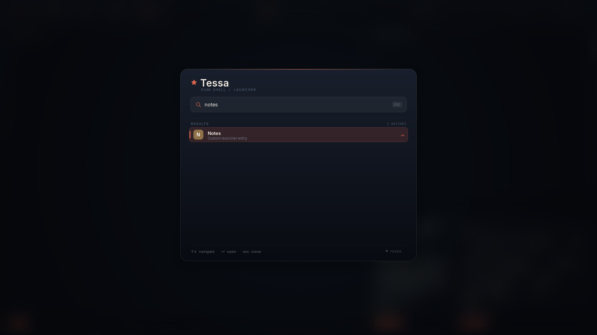

[English](EXTENDING.md) | **日本語**

<!-- tessa-site-notice:start -->
> [!NOTE]
> このドキュメントは Web サイトに移植されました。最新版は <https://keychrom.github.io/ja/docs/extending/> を参照してください。
<!-- tessa-site-notice:end -->

# Tessa を拡張する

Tessa はプラグイン VM や JavaScript 設定ランタイムを意図的に持っていません。
拡張はコンポジタの Unix ソケット API を話す通常のプロセスです。コアを小さく
保ち、任意の言語で拡張でき、信頼できないコードをコンポジタ本体へ読み込まずに
済みます。

ソケットは `$XDG_RUNTIME_DIR` 以下（通常 `tessa.sock`）にモード `0600` で
作成されます。同じユーザーは、ターミナルで実行するのと同じ権限で API から
コマンドを実行できます。



## tessa-ctl

`tessa-ctl` はリファレンス実装のクライアントで、`tessa` と `tessa-panel` と
同じ場所にインストールされます。

```sh
tessa-ctl state                         # スナップショットを 1 回表示
tessa-ctl hello                         # 行プロトコルのバージョン/機能一覧
tessa-ctl config                        # 実効設定とルールを表示
tessa-ctl config-check [file]           # 現在／候補設定を検証
tessa-ctl config-diff file              # 実効設定の差分をプレビュー
tessa-ctl config-edit [file]            # 編集・検証・差分・適用
tessa-ctl perf [--json] [--reset]       # 描画コミットのフレーム時間
tessa-ctl events                        # 全イベントを購読
tessa-ctl events window-focus           # 1 トピックだけ購読
tessa-ctl workspace 3                   # フォーカス中の出力
tessa-ctl workspace 3 HEADLESS-2        # 出力を指定
tessa-ctl spawn foot -T notes
tessa-ctl launcher fire                 # クエリは省略可能
tessa-ctl panel calendar                # パネルのポップオーバーを開閉
tessa-ctl panel clipboard              # クリップボード履歴
tessa-ctl panel screenshot             # 範囲/全画面スクリーンショット UI
tessa-ctl panel media                  # MPRIS メディア操作
tessa-ctl panel tray                   # StatusNotifier トレイ
tessa-ctl panel audio                  # 音量操作
tessa-ctl panel centered               # Wofi 風ランチャー
tessa-ctl panel start                  # Windows 風スタートメニュー
tessa-ctl shell                        # パネルと外部シェルのロール所有状態
tessa-ctl notify-action 12 reply       # 通知アクションを実行
tessa-ctl panel power HEADLESS-2        # 出力を指定
tessa-ctl layout grid                   # 現在のワークスペースのレイアウトを設定/巡回
tessa-ctl mode resize                   # 入力モードを切り替え
tessa-ctl resize 40 30                  # フォーカス中のフローティングウィンドウを拡大
tessa-ctl dispatch reload               # 任意のコンポジタコマンド
tessa-ctl quit
```

`dispatch` は先頭に `CMD` を付け、残りをコンポジタコマンドとして送ります。
ソケットパスは `$TESSA_IPC`、なければ
`$XDG_RUNTIME_DIR/tessa.sock` です。

## パネルモジュールとテーマトークン

内蔵パネルはコンポジタを起動せずにカタログを出力できます:

```sh
tessa-panel --list-modules          # テキスト形式の一覧
tessa-panel --list-modules --json   # 機械可読なレジストリ
tessa-panel --theme-json            # 解決済みセマンティックトークン
```

`--list-modules` はコアモジュールとコンテキストモジュールを区別します。
`layout`、`groups`、`mode`、`effects` は既存の IPC スナップショットから
コンポジタ状態を読むコンテキストモジュールで、別のシェルプロセスを起動しません。
外部モジュールは別シェルを起動せず、このレジストリと下記の宣言的エントリを
使います。

## 宣言的パネルウィジェット

`status` エントリが外部ウィジェットプロトコルです。プロセスが状態を所有し、
宣言的なピルを IPC で送ります:

```sh
tessa-ctl status weather "18C" --icon "☀" --priority 80 \
  --popover ~/.cache/tessa/weather.ui
tessa-ctl status weather --clear
```

`status` のフィールドは `id`、`text`、`icon`、`priority`、任意のクリック
コマンド（`--exec`）、任意のポップオーバーファイル（`--popover`）です。
優先度が高いエントリほどバーが狭いときも残り、隠れた件数は `+N` ピルで
表示されます。state のテキストと JSON にも icon、priority、popover パスが
含まれます。`examples/panel-widget.sh` は status のみの実行可能な例です。

### ウィジェットのポップオーバー

ポップオーバーファイルは小さな宣言的 UI です。ウィジェットがクリックされた
ときにパネルが読み込み、有効なテーマで描画し、アクションコマンドを実行します:

```ini
title = 東京
body = 晴れ、18℃、風弱め
action = 更新 | ~/.config/tessa/widgets/weather/refresh.sh
action = 予報 | xdg-open https://weather.example/
```

- `title` と `body` は 1 行ずつで、`body` は省略できます。
- `action = ラベル | コマンド` が行になります。最大 8 件です。コマンドは
  コンポジタの通常の spawn 経路で実行されます。`|` のない行は情報表示のみで、
  コマンドはありません。
- 相対パスはファイルを書くプロセス側で解決されるため、`--popover` には絶対
  パス（または `$XDG_RUNTIME_DIR/...`）を渡してください。
- パネルはファイルを監視しません。内容を変えたら status エントリを再送信して
  ください。次にクリックしたときに再読み込みされます。

`tessa-ctl panel module <widget-id>` はクリックせずに同じポップオーバーを開き、
モジュール開発中に便利です。`tessa-panel --popover-check <file>` はパネルを
起動せずにファイルを解析し、title とアクションを出力します。
`examples/panel-popover.sh` は完全な例を書き出して公開します。

ウィジェットモデルは意図的に宣言的で、パネル内コードやカスタム描画 API は
ありません。ポップオーバーは一般的なリスト／アクション面をカバーし、より
リッチな面が必要なら独自の layer-shell クライアントを開けます。バーの
エントリは同じ identity、priority、state モデルを保ちます。

`--theme-json` は解決済みの色、フォント、バー寸法、エフェクト状態を出力します。
外部シェルは Tessa の設定形式を解釈せずに、この JSON から見た目を合わせられます。
パネル側の設定、出力ルール、テーマロールが反映された値です。

セッション中は `tessa-ctl shell` でシェルロールの所有状態を確認できます。
background、bar、launcher、popovers、notifications、tray の `ROLE` 行と、
Tessa 以外のレイヤーシェル（Waybar、Quickshell など）の `EXTERNAL` 行を
表示します。部分的な共存時に、どのシェルがどの役割を持っているかを
推測せずに確認できます。

## 状態と購読

接続直後は何も送られません。パネルは次のように購読します。

```text
CMD subscribe all
```

その他のクライアントは用途に応じて選べます。

```text
CMD subscribe state     # スナップショットのみ
CMD subscribe events    # イベントのみ
CMD state               # 購読せずスナップショットを要求
```

スナップショットは行指向で、`END` で終わります。`STATE` から新しい
スナップショットが始まり、パネルは毎回バー全体を再構築します。`CONFIG` は
`tessa-ctl config` が使う別の要求/応答スナップショットで、実効設定、各
ワークスペースの `layout_ws`/`workspace_tuning` 行、`rule <raw>` 行、
`layer_rule <raw>` 行を含みます。主な状態行:

```text
MODE default
OUT HEADLESS-1 3 1 grid
FOCUSED 7
STATUS	weather	Tokyo 18C		☀	80
WIN	7	3	1	0	0	foot	notes	HEADLESS-1	40	30	1100	700	0	1	0	0	1	0	0
LAYER	tessa-bar	HEADLESS-1	2	0.940	12	1
```

`MODE` はアクティブな入力モードです。`OUT` は
`名前 ワークスペース フォーカス レイアウト` です。`WIN` はタブ区切りで、
id、ワークスペース、フォーカス、フローティング、フルスクリーン、エスケープ
された app_id、タイトル、出力名、x、y、幅、高さ、スクラッチパッド、可視状態、
グループ ID、グループアクティブ、オンスクリーン、Scrolling カラム ID、
0 始まりのタイル位置です。座標とサイズは
コンポジタの論理座標で、ウィンドウを追跡するツール向けに含まれます。
`LAYER` は namespace、出力名、レイヤー番号（`0` background … `3`
overlay）、実効不透明度、実効角丸、実効ブラー（`0`/`1`）です。`PANEL` は
出力名、パネル PID、監視中（`0`/`1`）、通知所有者（`0`/`1`）です。
`STATUS` は id、エスケープ済み text、クリックコマンド、icon、priority です。
古いコンシューマは最後の 2 フィールドを無視できます。

## JSON スナップショット

ツール向けに、状態と実効設定をバージョン付き JSON でも取得できます。
テキストコマンドもそのまま使えます。

```text
CMD state-json
STATE_JSON
{"schema":1,"active_workspace":1,"mode":"default","outputs":[...],"occupancy":[...],"focused":7,"statuses":[...],"windows":[...]}
END

CMD config-json
CONFIG_JSON
{"schema":1,"errors":0,"terminal":"kitty",...,"layouts":[...],"workspace_tuning":[...],"rules":[...],"hooks":[...],"diagnostics":[]}
END
```

`tessa-ctl state --json` と `tessa-ctl config --json` は JSON 行だけを出力
します。`STATE_JSON` と `CONFIG_JSON` はフレーミング用マーカーで、JSON 本体
ではありません。状態 JSON はアクティブな `mode`、`active_workspace_name`、
9 要素の `workspace_names` 配列を、設定 JSON は `modes` 配列と同じ
`workspace_names` 配列を含みます。行プロトコルには名前付きワークスペースの
`WORKSPACE <n> <name>` 行が追加されます。`schema` は現在 `1` です。未知の
バージョンは拒否してください。

状態のウィンドウには `id`、`workspace`、`focused`、`floating`、
`fullscreen`、`urgent`、`scratchpad`、`visible`、`group`、`group_active`、
`app_id`、`title`、`output`、`x`、`y`、`width`、`height` と、実効装飾値
`opacity`、`border_width`、`corner_radius`、`blur`、`shadow` が入ります。
さらに `tint`（RGBA 配列）、`animation` オブジェクト（`open_ms`、
`workspace_ms`、`close_ms`、`open_curve`、`workspace_curve`、`close_curve`。
`-1` と空文字は未設定）、`tearing`、`on_screen`、`column`、`tile` も含まれます。
テキストの `WIN` 行は末尾にスクラッチパッド、可視状態、グループ ID、
グループアクティブ、オンスクリーン、カラム ID、タイル位置を持ちますが、
tint と animation は含みません。`layers` 配列にはマップ済み
レイヤーサーフェスの `namespace`、`output`、`layer`、`opacity`、
`corner_radius`、`blur` が入ります。`tessa-ctl dispatch urgent <id> on|off`
でレイアウトヘルパーへ送る緊急度を切り替えられます。`CMD workspace` と
`CMD move-workspace` は数値のほかにワークスペース名も受け付けます。
グループ操作は `CMD toggle-group`、`CMD group-next`、`CMD group-prev`、
`CMD group-add`、`CMD group-remove` です。設定の
`diagnostics` は `severity`、`path`、`line`、`message` を持ちます。設定 JSON
は `event_rules`、`profiles`、`theme_roles`、`output_rules`、`layer_rules`、
`input_rules`、各件数、`cursor_theme`、`cursor_size` も出力します。ルール配列
の各要素は現在、検証済みの `raw` 文字列を含みます。`curves` の各要素は
`kind`（`bezier` または `spring`）を持ち、bezier は `points`、spring は
`damping` と `frequency` を含みます。

## JSON-RPC

同じソケットで、1 行の JSON オブジェクトによる JSON-RPC 2.0 リクエストを
受け付けます。行プロトコルも残り、同じ接続でどちらも使えます。

```json
{"jsonrpc":"2.0","id":1,"method":"hello"}
{"jsonrpc":"2.0","id":7,"method":"state"}
{"jsonrpc":"2.0","id":"cfg","method":"config"}
{"jsonrpc":"2.0","id":"sub-1","method":"subscribe"}
```

応答は `{"jsonrpc":"2.0","id":<リクエスト ID>,"result":...}` で、エラーは
標準 JSON-RPC コードです。メソッドは `hello` / `capabilities`、`ping`、
`state`、`config`、`subscribe`、`unsubscribe` です。`hello` は
`protocol: "tessa-jsonrpc"`、`version: 1`、`line_protocol: 1`、
`tessa: "0.2.5"`、`extension_api: 1`、`layout_api: 2`、`effect_api: 2` と、
`state`、`config`、`events`、`subscriptions`、`request-ids`、
`extensions`、`effects2` のケイパビリティを返します。state/config JSON も
`schema: 1`、`tessa`、API バージョンを含みます。

`subscribe` 後、ライフサイクルイベントは通知として届きます:

```json
{"jsonrpc":"2.0","method":"event","params":{"name":"window-open","id":7,"ws":1,"app":"foot","title":"notes","output":"eDP-1","subscription":"sub-1"}}
```

`subscription` はシリアライズされたリクエスト ID です。イベントはベスト
エフォートで、遅いクライアントはコンポジタを止めずに切断されます。変更操作は
引き続き行コマンドを使います。

テキストの `CMD config` にも、次の形式で診断が含まれます。

```text
diagnostic error /home/you/.config/tessa/config:12: unknown key 'widht'
```

エラーのあるリロードは拒否され、以前の設定が維持されます。
`tessa-ctl config-check` は診断を表示し、エラーが残っている間は非ゼロで
終了します。直近に読み込まれた、または拒否された設定を検査するため、
編集後はリロードしてから実行してください。

## イベント

イベントは key/value のレコードです。フィールドはタブ区切りで、値は
バックスラッシュ、タブ、改行、CR をエスケープします。最初の 2 フィールドは
必ず `EVENT` とトピック名です。

```text
EVENT	window-focus	id=7	previous=0	ws=3	app=foot	title=notes	output=HEADLESS-1
EVENT	workspace-change	ws=4	previous-ws=3	output=HEADLESS-1
EVENT	launcher	arg=fire	output=HEADLESS-1
EVENT	panel	arg=calendar	output=HEADLESS-1
EVENT	panel	arg=clipboard	output=HEADLESS-1
EVENT	panel	arg=screenshot	output=HEADLESS-1
EVENT	panel	arg=media	output=HEADLESS-1
EVENT	panel	arg=tray	output=HEADLESS-1
EVENT	panel	arg=audio	output=HEADLESS-1
EVENT	panel	arg=extensions	output=HEADLESS-1
EVENT	special-change	ws=3	output=HEADLESS-1	arg=notes
EVENT	notification-action	id=12	action=reply
```

該当しないフィールドは省略されます。`id` / `previous` はウィンドウ ID、
`ws` / `previous-ws` はワークスペース番号、`app`、`title`、`output`、`arg`
は文字列です。`window-focus` の `id=0` はフォーカス解除を意味し、`previous`
にはフォーカスを失ったウィンドウが入ります。`notification-action` は
全イベント購読者にブロードキャストされ、出力別の振り分けはなく `output`
フィールドも持ちません。受信側は通知 ID で判別してください。

| トピック | タイミング | 主なフィールド |
| --- | --- | --- |
| `startup` | バックエンド起動・XWayland 起動後 | — |
| `shutdown` | イベントループ終了前 | — |
| `window-open` | トップレベルがマップされた | id, ws, app, title, output |
| `window-close` | マップ済みトップレベルが破棄された | id, ws, app, title, output |
| `window-focus` | ウィンドウフォーカス変更/解除 | id, previous, ws, app, title, output |
| `workspace-change` | 出力のワークスペース変更 | ws, previous-ws, output |
| `special-change` | スペシャル WS の表示/非表示、移動 | ws, output, arg（名前。復帰時は省略） |
| `window-moved` | ウィンドウを別ワークスペースへ移動 | id, ws, previous-ws, app, title, output |
| `layout-change` | ワークスペースのレイアウト変更 | ws, output, arg |
| `mode-change` | アクティブ入力モードの変更 | arg（モード名） |
| `config-reload` | 設定の再読み込み成功 | — |
| `launcher` | ランチャー要求 | arg（クエリ）, output |
| `panel` | パネルのポップオーバー要求 | arg（`calendar`、`power`、`clipboard`、`screenshot`、`media`、`tray`、`audio`、`extensions`、`module <widget-id>`）, output |
| `notification-action` | IPC 経由の通知アクション要求 | id, action（アクションキー） |
| `output-added` | 出力初期化 | output, arg（ジオメトリ） |
| `output-removed` | 出力削除 | output, arg（ジオメトリ） |
| `animation-start` | ウィンドウ表示/ワークスペーススライド開始 | id, ws, output, arg（`open` / `workspace`） |
| `animation-done` | ウィンドウ表示/ワークスペーススライド完了 | id, ws, output, arg（`open` / `workspace`） |
| `close-animation-start` | コンポジタ起点の終了スナップショット開始 | id, ws, output, arg（`close`） |
| `close-animation-done` | 終了スナップショットのフェード完了 | id, ws, output, arg（`close`） |
| `extension-start` | 監視対象の拡張プロセス開始 | arg（拡張 ID） |
| `extension-ready` | 拡張が token で認証 | arg |
| `extension-failed` | 拡張が異常終了 | arg（エラー文はなし） |
| `extension-stop` | 拡張を明示的に停止 | arg |

イベントは `CMD subscribe events` または `CMD subscribe all` で購読した
クライアントにだけ届きます。ベストエフォート配信です。読み取りが遅れて
ソケットバッファが埋まったクライアントは、コンポジタをブロックせず切断
されます。

`notification-action` は例外で、イベント購読者へ直接ブロードキャストされ、
`hook` や `event-rule` は実行されません（設定検証はトピック名を受け付けます）。
他のトピックは通常のイベント経路でフックとイベントルールを実行します。

## フック

`notification-action` を除く任意のイベントからシェルコマンドを起動できます。
同じイベントに複数のフックを登録できます。

```ini
startup = fcitx5 -d
hook = window-open notify-send "Window opened" "$TESSA_TITLE"
hook = workspace-change ~/.config/tessa/workspace.sh
hook = config-reload ~/.config/tessa/reload-shell.sh
```

フックプロセスはコンポジタの環境（`TESSA_IPC`、`WAYLAND_DISPLAY`、
XWayland 有効時の `DISPLAY` など）を継承し、さらに次を受け取ります。

| 変数 | 意味 |
| --- | --- |
| `TESSA_EVENT` | トピック名 |
| `TESSA_WINDOW_ID` | `id` フィールド |
| `TESSA_PREVIOUS_ID` | `previous` フィールド |
| `TESSA_WORKSPACE` | `ws` フィールド |
| `TESSA_PREVIOUS_WORKSPACE` | `previous-ws` フィールド |
| `TESSA_APP_ID` | `app` フィールド |
| `TESSA_TITLE` | `title` フィールド |
| `TESSA_OUTPUT` | `output` フィールド |
| `TESSA_ARG` | `arg` フィールド |
| `TESSA_FOCUSED_ID` | 現在のフォーカス ID（なければ `0`） |
| `TESSA_ACTIVE_WORKSPACE` | フォーカス出力のアクティブワークスペース |
| `TESSA_FOCUSED_OUTPUT` | フォーカス出力名 |

## イベントルール

`event-rule` は条件付きフックです。ウィンドウルールと同じ真偽値／POSIX
正規表現の式を使い、追加で `event`、`ws`、`id` を参照できます:

```ini
event-rule = window-open; match=app ~ "^firefox$" && ws == "2"; run=notify-send "Firefox" "workspace 2"
event-rule = workspace-change; match=ws == "3"; run=~/bin/on-workspace-3
```

最初の節がイベント名（`event=` でも可）、`match`/`expr` は任意、
`run`/`command` は必須です。一致したルールは設定順に、無条件 `hook` より
先に実行され、同じ `TESSA_*` 環境を受け取ります。`tessa-ctl config` は
`event_rule_count` と解析済みルールを表示します。

フックは投げっぱなしで並行に実行されます。順序保証はなく、フックが状態を
変えると次のイベントを発生させることがあります。コマンドはセッション
ユーザーの全権限を持ちます。

## ステータスエントリ

プロセスはバーへ短いテキストを公開できます。

```sh
tessa-ctl status weather "Tokyo 18C"
tessa-ctl status weather "Tokyo 18C" --exec "weather-app"
tessa-ctl status weather --clear
```

id は安定しており、同じ id を更新すると位置を変えずにテキストだけが
置き換わります。エントリは全出力で共有されます。最大 8 件で、満杯の状態で
新しい id が来ると最も古いものが追い出されます。テキストは 159 バイトまで
保存され、表示時には幅に合わせて切り詰められます。クリックコマンドを指定
すると、そのエントリのクリックで `CMD spawn <コマンド>` がコンポジタへ
送られます。id だけ指定して空文字にすると削除されます。

意図的にテキスト専用 API であり、画像/アイコンのプロトコルではありません。
拡張はタイマーまたはイベントに応じてテキストを更新します。

## 外部レイアウトヘルパー

独自のタイルアルゴリズムには `layout = custom` と `layout_helper` を設定します。
Tessa はヘルパープロセスを保持し、使用可能領域、ウィンドウ ID、app-id/
タイトルと、返されたフレーム矩形をタブ区切りで交換します。プロトコル全体、
タイムアウト、フォールバックの仕様は
[CUSTOMIZATION.ja.md](CUSTOMIZATION.ja.md#外部レイアウトヘルパー) にあります。

## エフェクトヘルパープロトコル

`effect_helper` はコンポジタごとに 1 つの常駐プロセスを起動します。現在は
v2 で、`VERSION 1` を返すヘルパーは従来の位置引数形式のまま動作します。
リクエストはタブ区切りです:

```text
HELLO\t2
EFFECT\t2
WINDOW\t<id>\t<app-id>\t<title>\t<output>\t<ws>\t<focused>\t<urgent>\t<fullscreen>\t<floating>\t<visible>\t<opacity>\t<corner-radius>\t<blur>\t<shadow>\t<border-width>\t<x>\t<y>\t<w>\t<h>\t[<tint>]
...
END
```

`tint` は v2 交渉後のリクエストだけ末尾に付きます。v2 応答は key=value
形式です:

```text
VERSION\t2
WINDOW\t<id>\topacity=0.9\tradius=16\tblur=on\tshadow=off\tborder-width=2\ttint=#ff8844aa\topen-ms=240\topen-curve=spring-soft
...
END
```

各フィールドは任意で、省略時はルール値を使います。`tint` は
`#RRGGBBAA`/`none`、アニメーションは `animation-ms`、`open-ms`、
`workspace-ms`、`close-ms`（-1〜1000、-1 は継承）と `curve`、
`open-curve`、`workspace-curve`、`close-curve` を受け付けます。カーブ名は
`bezier`/`spring` 登録済みか組み込み名でなければなりません。ID だけの
WINDOW はそのウィンドウの上書きを解除します。

Tessa は ID、重複、範囲、カーブ名を検証します。タイムアウト、クラッシュ、
未知の ID、不正値、`END` 欠落では全上書きを破棄します。再試行は専用タイマー
ではなく、1 秒後の次回 refresh 時に遅延して行われます。
stdout はプロトコル専用で、診断は stderr に出してください。v1 の位置引数
応答も引き続き受理します（タブ区切りで
`WINDOW\t<id>\t<opacity>\t<radius>\t<blur>\t<shadow>\t<border-width>`）。

最小例:

```python
#!/usr/bin/env python3
import sys

while True:
    lines = []
    while True:
        line = sys.stdin.readline()
        if not line:
            raise SystemExit(0)
        line = line.rstrip("\n")
        if line == "END":
            break
        lines.append(line.split("\t"))
    out = ["VERSION\t2"]
    for fields in lines:
        if fields[0] != "WINDOW":
            continue
        window_id, app_id, title = fields[1], fields[2], fields[3]
        if app_id == "org.example.notes" or "notes" in title.lower():
            out.append(f"WINDOW\t{window_id}\topacity=0.92\tradius=18\topen-ms=220\topen-curve=spring-soft")
    out.append("END")
    sys.stdout.write("\n".join(out) + "\n")
    sys.stdout.flush()
```

```ini
effect_helper = python3 ~/.config/tessa/effects.py
effect_helper_timeout = 200
```

ヘルパーはコンポジタと同じ権限で動き、サンドボックスはありません。調整
できるのは宣言済みの視覚・アニメーションプロパティだけで、コンポジタ内への
シェーダー注入やコード実行はできません。`tests/effect-helper.sh` が v1
互換性、`tests/effect-v2.sh` が tint/アニメーションとピクセル、
`tests/effect-cache.sh` が再適用の再利用を検証します。

## 監視付き拡張機能

`extension` は監視対象のプロセスを宣言します。通常の IPC クライアントと
同じソケットを使い、環境変数の token で自分を通知します。

```ini
extension = id=weather; command=weatherd; api=1; permissions=read,status
extension = id=theme; command=tessa-theme; api=1; requires=weather; after=weather
```

`api` はコンポジタの拡張 API と照合されます。`permissions` は `read`、
`events`、`status`、`window`、`workspace`、`layout`、`spawn`、`panel`、
`control`、`extensions` のカンマ区切り（`all`/`none` 可）で、既定は
`read,status` です。`requires`/`after` は拡張 ID で、未知 ID、重複、自己依存、
両方への指定、循環は設定エラーです。トポロジカル順に起動し、pidfd で終了を
検知して指数バックオフ（1 秒、2 秒、4 秒、以降 8 秒。10 秒以上安定すると
失敗回数をリセット）で再起動します。`requires` は依存先が `ready` になるまで
待ち、無効・blocked・failed の間は依存元も `blocked` です。`after` は順序に
だけ影響します。起動済みの依存元は、依存先が後から失敗しても停止されず、次回の
起動試行時に再度 `requires` を確認します。`extension_ready_timeout`（既定
10000 ms、`0` で無効）は、起動したまま認証しないプロセスを停止します。
トークンは起動ごとに再生成され、停止・無効化・クラッシュ・reload で認証済み
接続が失効します。完全な契約は [EXTENSION-API.ja.md](EXTENSION-API.ja.md) を
参照してください。

```text
HELLO 1 $TESSA_EXTENSION_TOKEN
VERSION 1
CAPABILITIES ...
EXTENSION weather read,status
```

権限外は `ERR forbidden <command>`、不正 token は `ERR unauthorized` を返し、
その接続は権限なしになります。トークンを含む不正な `HELLO` も fail-closed
です。scoped クライアントの未知コマンドは
`ERR unknown-command <command>` になります。`subscribe state` は `read`、
`subscribe events` は `events`、`subscribe all` は両方が必要です。
これはサンドボックスではなく協調的な制御です。
token を送らない `tessa-panel` と `tessa-ctl` は従来どおり全権限です。

`CMD extensions`/`CMD extensions-json` で状態一覧、
`CMD extension-enable <id> on|off` で現在のセッションだけ切り替えます。
JSON には `last_error`、`failures`、`next_restart_ms` も含まれます。
イベントは `extension-start`、`extension-ready`、`extension-failed`、
`extension-stop` です。パネルの一覧は `tessa-ctl panel extensions` で開き、
Enter で選択項目を切り替えます。

## ランチャー項目と include

パネルのランチャーは通常の `.desktop` ファイルを走査します。加えて、設定から
直接コマンドを追加できます。

```ini
launcher_entry = Notes | foot -e nvim ~/notes.md
launcher_entry = Lock screen | swaylock
```

名前は通常のランチャー検索の対象になり、`|` の後ろのコマンドが `/bin/sh`
経由で実行されます。コンポジタが `config-reload` を発行するとパネルも設定を
読み直すため、`Super+R` で両方が更新されます。

設定ファイルは別ファイルを include できます。

```ini
include = /home/you/.config/tessa/keybindings.conf
include = /home/you/.config/tessa/launcher-entries.conf
```

相対パスは include 元のファイルの隣として解決されます。include の深さは
8 段までです。循環 include を作らないでください。

## サンプル

[`examples/active-window.sh`](../examples/active-window.sh) は
`window-focus` を購読し、フォーカス中のタイトルを `active` ステータスとして
表示します。Tessa 内で起動したターミナルから実行してください。

```sh
sh examples/active-window.sh
```

## 拡張のテスト

リポジトリには自己完結した headless テストがあります。

```sh
./scripts/build.sh
sh tests/extensions.sh
sh tests/extension-api.sh
sh tests/smoke.sh
```

`tests/extension-api.sh` は安定版 v1 契約（fail-closed HELLO、スコープ検査、
購読リセット、トークン回転/失効、ready timeout、`after` の起動順、JSON 診断）
を確認します。契約本体は
[EXTENSION-API.ja.md](EXTENSION-API.ja.md) を参照してください。
`tests/smoke.sh` は設定 include、startup / workspace-change / config-reload
フック、イベントストリーム、ステータスの設定と削除、IPC の半クローズ処理、
`foot` がインストールされていればウィンドウの生成・フォーカス・終了イベントを
確認します。`TESSA_CTL_DEBUG=1 tessa-ctl events` は受信行を stderr に表示します。

## 現在の制限

JSON スナップショットは `schema: 1` でバージョン管理しています。JSON-RPC は
読み取り、リクエスト ID、ケイパビリティ交渉、JSON イベント購読を提供します
が、変更操作は行コマンドを使います。拡張には依存順序と協調的な token
スコープがありますが、サンドボックス、署名、marketplace、拡張ごとの設定
フォームはありません。`extension-enable` はセッション内だけです。
投げっぱなしコマンドの ACK はなく、ステータスはテキストのみです。
レイアウトヘルパーの応答は完成したスナップショットで、矩形の部分
ストリーミング更新には対応していません。在庫 wlroots の scene API には
ウィンドウ単位のカスタムシェーダーフックがないため、エフェクトヘルパーは
宣言済みの視覚・アニメーションプロパティだけを扱います。組み込みの
オフスクリーンエフェクト（`shader=` ウィンドウルール）はコンポジタが
選択する方式です。次段階は uniform 付きの背景フレーム常駐シェーダーです。
