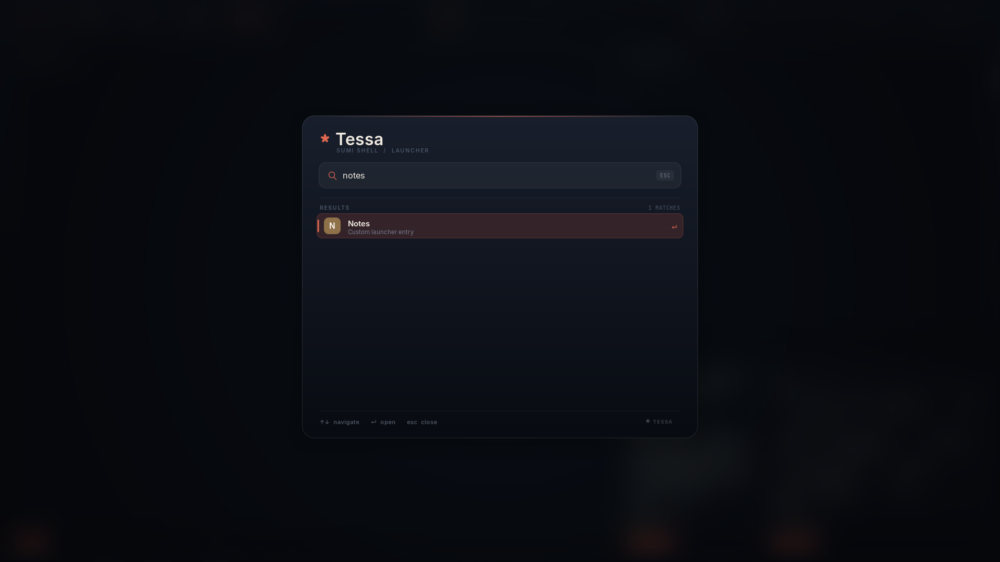

**English** | [日本語](EXTENDING.ja.md)

<!-- tessa-site-notice:start -->
> [!NOTE]
> This document has been ported to the website. Read the current version at <https://keychrom.github.io/docs/extending/>.
<!-- tessa-site-notice:end -->

# Extending Tessa

Tessa deliberately has no plugin VM and no JavaScript configuration runtime.
Extensions are ordinary processes that speak the compositor's Unix-socket API.
That keeps the core small, makes extensions possible in any language, and avoids
loading untrusted code into the compositor process.

The socket is created with mode `0600` under `$XDG_RUNTIME_DIR` (normally
`tessa.sock`). The same user can run any command through the API, exactly as if
they had run it in a terminal.



## tessa-ctl

`tessa-ctl` is the reference client. It is installed next to `tessa` and
`tessa-panel`.

```sh
tessa-ctl state                         # one snapshot
tessa-ctl hello                         # line protocol version/capabilities
tessa-ctl config                        # effective configuration + rules
tessa-ctl config-check [file]           # validate current or candidate config
tessa-ctl config-diff file              # preview effective changes
tessa-ctl config-edit [file]            # edit, validate, diff, apply
tessa-ctl perf [--json] [--reset]       # render-commit frame timings
tessa-ctl events                        # stream all events
tessa-ctl events window-focus           # stream one topic
tessa-ctl workspace 3                   # focused output
tessa-ctl workspace 3 HEADLESS-2        # a specific output
tessa-ctl spawn foot -T notes
tessa-ctl launcher fire                 # query is optional
tessa-ctl panel calendar                # toggle a panel popover
tessa-ctl panel clipboard              # clipboard history
tessa-ctl panel screenshot             # region/full screenshot UI
tessa-ctl panel media                  # MPRIS controls
tessa-ctl panel tray                   # StatusNotifier tray
tessa-ctl panel audio                  # volume controls
tessa-ctl panel centered               # Wofi-style launcher
tessa-ctl panel start                  # Windows-style start menu
tessa-ctl shell                        # panel and external shell role ownership
tessa-ctl notify-action 12 reply       # invoke a notification action
tessa-ctl panel power HEADLESS-2        # target a specific output
tessa-ctl layout grid                   # set/cycle current workspace layout
tessa-ctl mode resize                   # switch input mode
tessa-ctl resize 40 30                  # grow the focused floating window
tessa-ctl dispatch reload               # any compositor command
tessa-ctl quit
```

`dispatch` adds `CMD` and sends the rest of the line as a compositor command.
The socket path is `$TESSA_IPC`, or `$XDG_RUNTIME_DIR/tessa.sock`.

## Panel modules and theme tokens

The built-in panel exposes its catalogue without a running compositor:

```sh
tessa-panel --list-modules          # text catalogue
tessa-panel --list-modules --json   # machine-readable registry
tessa-panel --theme-json            # resolved semantic tokens
```

`--list-modules` distinguishes core modules from context modules. The context
modules `layout`, `groups`, `mode`, and `effects` read compositor state over the
existing IPC snapshot; they do not start a second shell process. External
modules use this same registry and the declarative entry below instead of
starting a second shell process.

## Declarative panel widgets

The `status` entry is the external widget protocol. A process owns its state and
pushes a declarative pill over IPC:

```sh
tessa-ctl status weather "18C" --icon "☀" --priority 80 \
  --popover ~/.cache/tessa/weather.ui
tessa-ctl status weather --clear
```

`status` fields are `id`, `text`, `icon`, `priority`, an optional click command
(`--exec`), and an optional popover file (`--popover`). Higher priorities stay
visible when the bar is narrow; hidden entries are represented by a `+N` pill.
State text and JSON include the icon, priority, and popover path.
`examples/panel-widget.sh` is a runnable status-only reference.

### Widget popovers

A popover file is a tiny declarative UI. The panel reads it when the widget is
clicked, renders it with the active theme, and runs action commands itself:

```ini
title = Tokyo
body = Clear, 18 C, light wind
action = Refresh | ~/.config/tessa/widgets/weather/refresh.sh
action = Forecast | xdg-open https://weather.example/
```

- `title` and `body` are single lines; `body` may be omitted.
- `action = Label | command` adds a row. Up to eight actions are read.
  Commands run through the compositor's normal spawn path. A row without `|`
  is shown as information and has no command.
- Relative paths are resolved by the process that writes the file; pass an
  absolute path (or `$XDG_RUNTIME_DIR/...`) to `--popover`.
- The panel does not watch the file. Rewrite it and re-publish the status entry
  when the content changes; clicking again reloads it.

`tessa-ctl panel module <widget-id>` opens the same popover without clicking,
which is useful while developing a module. `tessa-panel --popover-check <file>`
parses a file and prints its title/actions without starting the panel.
`examples/panel-popover.sh` writes a complete example and publishes it.

The widget model is intentionally declarative: it has no in-panel code and no
custom drawing API. Popovers cover the common list/action surface; richer
surfaces can open their own layer-shell client while the bar entry keeps the
same identity, priority, and state model.

`--theme-json` exports resolved colors, fonts, bar geometry, and effect
switches. External shells can consume it to match Tessa without importing
Tessa's config format. Panel-only settings are resolved first, so the JSON
reflects output rules and theme roles.

Use `tessa-ctl shell` to inspect shell role ownership while a session is
running. It prints `PANEL` and `ROLE` lines for background, bar, launcher,
popovers, notifications, and tray, followed by `EXTERNAL` entries for non-Tessa
layer-shell clients. This makes partial coexistence explicit instead of
requiring a guess about which shell owns a surface.

## State and subscriptions

A newly accepted connection receives nothing until it subscribes. The panel
sends:

```text
CMD subscribe all
```

Other clients can choose:

```text
CMD subscribe state     # snapshots only
CMD subscribe events    # events only
CMD state               # request one snapshot without subscribing
```

Snapshots are line-oriented and end with `END`. `STATE` begins a new snapshot;
the panel reconstructs its entire bar from each snapshot. `CONFIG` is a separate
request/response snapshot used by `tessa-ctl config`; it contains effective
settings, `layout_ws`/`workspace_tuning` lines for each workspace, `rule <raw>`
and `layer_rule <raw>` lines. The most useful state lines are:

```text
MODE default
OUT HEADLESS-1 3 1 grid
FOCUSED 7
STATUS	weather	Tokyo 18C		☀	80
WIN	7	3	1	0	0	foot	notes	HEADLESS-1	40	30	1100	700	0	1	0	0	1	0	0
LAYER	tessa-bar	HEADLESS-1	2	0.940	12	1
```

`MODE` is the active input mode. `OUT` is `name workspace focused layout`.
`WIN` fields are tab-separated in this order: id,
workspace, focused, floating, fullscreen, escaped app_id, escaped title, output,
x, y, width, height, scratchpad, visible, group id, group-active, on-screen,
scrolling column id, and 0-based tile index. Geometry is in logical compositor
coordinates and is included for tooling that tracks windows. `LAYER` is
`namespace`, output,
layer number (`0` background … `3` overlay), effective opacity, effective
corner radius, and effective blur (`0`/`1`). `PANEL` is output, panel pid,
supervised (`0`/`1`), and notification-owner (`0`/`1`). `STATUS` is id, escaped
text, click command, icon, and priority; older consumers can ignore the last
two fields.

## JSON snapshots

For tools, state and effective configuration are available as versioned JSON.
The text commands still work:

```text
CMD state-json
STATE_JSON
{"schema":1,"active_workspace":1,"mode":"default","outputs":[...],"occupancy":[...],"focused":7,"statuses":[...],"windows":[...]}
END

CMD config-json
CONFIG_JSON
{"schema":1,"errors":0,"terminal":"kitty",...,"layouts":[...],"workspace_tuning":[...],"rules":[...],"hooks":[...],"diagnostics":[]}
END
```

`tessa-ctl state --json` and `tessa-ctl config --json` print only the JSON line.
`STATE_JSON` and `CONFIG_JSON` are framing markers, not part of the JSON.
State JSON includes the active `mode`, `active_workspace_name`, and a
nine-element `workspace_names` array; the line protocol adds
`WORKSPACE <n> <name>` lines for named workspaces. Config JSON includes a
`modes` array and the same `workspace_names` array. `schema` is currently `1`;
consumers should reject unknown versions.

State windows contain `id`, `workspace`, `focused`, `floating`, `fullscreen`,
`urgent`, `scratchpad`, `visible`, `group`, `group_active`, `app_id`, `title`,
`output`, `x`, `y`, `width`, `height`, and the effective decoration fields
`opacity`, `border_width`, `corner_radius`, `blur`, and `shadow`. They also
carry `tint` (RGBA array), an `animation` object (`open_ms`, `workspace_ms`,
`close_ms`, `open_curve`, `workspace_curve`, `close_curve`; `-1` and empty
strings mean "unset"), `tearing`, `on_screen`, `column`, and `tile`. The text
`WIN` line ends with scratchpad, visibility, group id, group-active, on-screen,
column, and tile, but has no tint or animation fields.
The `layers` array contains `namespace`, `output`, `layer`, `opacity`,
`corner_radius`, and `blur` for mapped layer-shell surfaces. Config
`diagnostics` entries contain `severity`, `path`, `line`, and `message`.
`tessa-ctl dispatch urgent <id> on|off` toggles the urgency flag sent to layout
helpers. `CMD workspace` and `CMD move-workspace` accept a workspace name as
well as a number. Group control uses `CMD toggle-group`, `CMD group-next`,
`CMD group-prev`, `CMD group-add`, and `CMD group-remove`.
Config JSON also exposes `event_rules`, `profiles`, `theme_roles`,
`output_rules`, `layer_rules`, `input_rules`, the corresponding counts, and
`cursor_theme` / `cursor_size`. Rule arrays currently contain each rule's
validated `raw` text. Each `curves` entry has a `kind` of `bezier` or `spring`;
bezier entries include `points`, spring entries include `damping` and
`frequency`.

## JSON-RPC

The same socket accepts JSON-RPC 2.0 requests as single-line JSON objects. The
line protocol remains available; a connection can use either style.

```json
{"jsonrpc":"2.0","id":1,"method":"hello"}
{"jsonrpc":"2.0","id":7,"method":"state"}
{"jsonrpc":"2.0","id":"cfg","method":"config"}
{"jsonrpc":"2.0","id":"sub-1","method":"subscribe"}
```

Responses are `{"jsonrpc":"2.0","id":<request id>,"result":...}` and errors use
standard JSON-RPC codes. Supported methods are `hello` / `capabilities`,
`ping`, `state`, `config`, `subscribe`, and `unsubscribe`. `hello` returns
`protocol: "tessa-jsonrpc"`, `version: 1`, `line_protocol: 1`,
`tessa: "0.2.5"`, `extension_api: 1`, `layout_api: 2`, `effect_api: 2`, and the
capabilities `state`, `config`, `events`, `subscriptions`, `request-ids`,
`extensions`, and `effects2`. State/config JSON also carries `schema: 1`,
`tessa`, and the API versions.

After `subscribe`, every lifecycle event is sent as a notification:

```json
{"jsonrpc":"2.0","method":"event","params":{"name":"window-open","id":7,"ws":1,"app":"foot","title":"notes","output":"eDP-1","subscription":"sub-1"}}
```

`subscription` is the serialized request id. Events are best-effort; a slow
client is disconnected rather than blocking the compositor. Mutation remains
on the line command plane.

Text `CMD config` also includes diagnostics in this human-readable form:

```text
diagnostic error /home/you/.config/tessa/config:12: unknown key 'widht'
```

A reload with errors is rejected and keeps the previous configuration.
`tessa-ctl config-check` prints diagnostics and exits non-zero while errors
remain. It checks the most recently loaded or rejected configuration, so run a
reload after editing.

## Events

Events are key/value records. Tabs separate fields and values are escaped
(`\`, `\t`, `\n`, `\r`). The first two fields are always `EVENT` and the topic:

```text
EVENT	window-focus	id=7	previous=0	ws=3	app=foot	title=notes	output=HEADLESS-1
EVENT	workspace-change	ws=4	previous-ws=3	output=HEADLESS-1
EVENT	launcher	arg=fire	output=HEADLESS-1
EVENT	panel	arg=calendar	output=HEADLESS-1
EVENT	panel	arg=clipboard	output=HEADLESS-1
EVENT	panel	arg=screenshot	output=HEADLESS-1
EVENT	panel	arg=media	output=HEADLESS-1
EVENT	panel	arg=tray	output=HEADLESS-1
EVENT	panel	arg=audio	output=HEADLESS-1
EVENT	panel	arg=extensions	output=HEADLESS-1
EVENT	special-change	ws=3	output=HEADLESS-1	arg=notes
EVENT	notification-action	id=12	action=reply
```

Fields are omitted when they do not apply. `id` and `previous` are ids; `ws` and
`previous-ws` are workspace numbers; `app`, `title`, `output`, and `arg` are
strings. The `window-focus` topic with `id=0` means focus was cleared; `previous`
names the window that lost focus. `notification-action` is broadcast to every
event subscriber (there is no per-output routing); it carries no `output`
field, so receivers filter by notification id.

| Topic | When | Useful fields |
| --- | --- | --- |
| `startup` | Backend started, XWayland launched | — |
| `shutdown` | Event loop is leaving | — |
| `window-open` | A toplevel is mapped | id, ws, app, title, output |
| `window-close` | A mapped toplevel is destroyed | id, ws, app, title, output |
| `window-focus` | Window focus changes or clears | id, previous, ws, app, title, output |
| `workspace-change` | An output changes workspace | ws, previous-ws, output |
| `special-change` | Special workspace shown/hidden or window moved | ws, output, arg (name; omitted when restoring) |
| `window-moved` | Window sent to another workspace | id, ws, previous-ws, app, title, output |
| `layout-change` | Workspace layout changed | ws, output, arg |
| `mode-change` | Active input mode changed | arg (mode name) |
| `config-reload` | Config successfully reloaded | — |
| `launcher` | Launcher requested | arg (query), output |
| `panel` | A panel popover was requested | arg (`calendar`, `power`, `clipboard`, `screenshot`, `media`, `tray`, `audio`, `extensions`, or `module <widget-id>`), output |
| `notification-action` | A notification action was requested through IPC | id, action (action key) |
| `output-added` | Output initialized | output, arg (geometry) |
| `output-removed` | Output removed | output, arg (geometry) |
| `animation-start` | Window open or workspace slide starts | id, ws, output, arg (`open` or `workspace`) |
| `animation-done` | Window open or workspace slide finishes | id, ws, output, arg (`open` or `workspace`) |
| `close-animation-start` | A compositor-initiated close snapshot starts | id, ws, output, arg (`close`) |
| `close-animation-done` | The close snapshot has faded out | id, ws, output, arg (`close`) |
| `extension-start` | A supervised extension process started | arg (extension id) |
| `extension-ready` | An extension authenticated with its token | arg |
| `extension-failed` | An extension exited unexpectedly | arg (no error text) |
| `extension-stop` | An extension was stopped deliberately | arg |

Events are delivered only to clients that asked for them with
`CMD subscribe events` or `CMD subscribe all`. They are best-effort: a slow
client with a full socket buffer is disconnected rather than blocking the
compositor.

`notification-action` is a special case: it is broadcast directly to event
subscribers and does **not** run `hook` or `event-rule` entries, even though
config validation accepts the topic. Hooks and event rules run for the other
topics through the normal event path.

## Hooks

Any event except `notification-action` can launch a shell command. Multiple
hooks per event are allowed.

```ini
startup = fcitx5 -d
hook = window-open notify-send "Window opened" "$TESSA_TITLE"
hook = workspace-change ~/.config/tessa/workspace.sh
hook = config-reload ~/.config/tessa/reload-shell.sh
```

The hook process inherits the compositor environment (including `TESSA_IPC`,
`WAYLAND_DISPLAY`, and `DISPLAY` when XWayland is active) plus:

| Variable | Meaning |
| --- | --- |
| `TESSA_EVENT` | Topic name |
| `TESSA_WINDOW_ID` | `id` field |
| `TESSA_PREVIOUS_ID` | `previous` field |
| `TESSA_WORKSPACE` | `ws` field |
| `TESSA_PREVIOUS_WORKSPACE` | `previous-ws` field |
| `TESSA_APP_ID` | `app` field |
| `TESSA_TITLE` | `title` field |
| `TESSA_OUTPUT` | `output` field |
| `TESSA_ARG` | `arg` field |
| `TESSA_FOCUSED_ID` | Current focused window id, or `0` |
| `TESSA_ACTIVE_WORKSPACE` | Focused output's active workspace |
| `TESSA_FOCUSED_OUTPUT` | Focused output name |

Hooks are fire-and-forget and run concurrently. They are not ordered, and a hook
that changes state can cause further events. Commands receive the full privileges
of the session user.

## Event rules

`event-rule` is a filtered hook. It uses the same boolean/POSIX-regex expression
language as window rules and additionally exposes `event`, `ws`, and `id`:

```ini
event-rule = window-open; match=app ~ "^firefox$" && ws == "2"; run=notify-send "Firefox" "workspace 2"
event-rule = workspace-change; match=ws == "3"; run=~/bin/on-workspace-3
```

The first clause is the event name (or `event=`), `match`/`expr` is optional,
and `run`/`command` is required. Matching rules execute in config order before
unconditional `hook` entries and receive the same `TESSA_*` environment.
`tessa-ctl config` shows `event_rule_count` and each parsed rule.

## Status entries

A process can publish a small text entry in the bar:

```sh
tessa-ctl status weather "Tokyo 18C"
tessa-ctl status weather "Tokyo 18C" --exec "weather-app"
tessa-ctl status weather --clear
```

The id is stable: updating an existing id replaces its text in place. Entries are
global across outputs. At most eight entries are kept; the oldest is evicted when
a new id arrives and the table is full. Text is stored up to 159 bytes and is
truncated for display. If a click command is supplied, clicking the entry sends
`CMD spawn <command>` to the compositor. Clearing an id removes it.

This is intentionally a text API, not an image/icon protocol. An extension can
update text on a timer or in response to events.

## Supervised extensions

`extension` declares a supervised process. It uses the same control socket as
other clients, but identifies itself with the token in its environment:

```ini
extension = id=weather; command=weatherd; api=1; permissions=read,status
extension = id=theme; command=tessa-theme; api=1; requires=weather; after=weather
```

`api` is checked against the compositor's extension API. `permissions` is a
comma-separated subset of `read`, `events`, `status`, `window`, `workspace`,
`layout`, `spawn`, `panel`, `control`, and `extensions` (`all`/`none` allowed).
The default is `read,status`. `requires` and `after` are extension ids; unknown
ids, duplicates, self-dependencies, an id in both lists, and cycles are config
errors. The supervisor starts in topological order, uses pidfd exit detection,
and restarts with exponential backoff (1 s, 2 s, 4 s, then 8 s; a run of at
least 10 s resets the failure counter). `requires` waits for the dependency to
be `ready`; a disabled, blocked, or failed required dependency keeps the
dependent `blocked`. `after` affects ordering only. A dependent that is already
running is not stopped when its dependency later fails; on its own next start
attempt the requirement is checked again. `extension_ready_timeout` (default
10000 ms, `0` disables) kills a process that starts but never authenticates.
Tokens are regenerated on every start, and stopping, disabling, crashing, or
reloading an extension revokes its authenticated connections. The full contract
is in [EXTENSION-API.md](EXTENSION-API.md).

```text
HELLO 1 $TESSA_EXTENSION_TOKEN
VERSION 1
CAPABILITIES ...
EXTENSION weather read,status
```

Commands outside the granted scopes return `ERR forbidden <command>`. A wrong
token returns `ERR unauthorized` and leaves the connection with no scopes;
malformed `HELLO` lines that contain a token are also fail-closed. Scoped
clients get `ERR unknown-command <command>` for unknown commands. `subscribe
state` requires `read`, `subscribe events` requires `events`, and `subscribe
all` requires both. This is a cooperative permission check, not a sandbox:
extensions run as the same user and can read the token or call the socket
directly. Clients that do not send a token, including `tessa-panel` and
`tessa-ctl`, keep full access.

`CMD extensions` lists runtime state; `CMD extensions-json` returns the same
data as JSON, including `last_error`, `failures`, and `next_restart_ms`.
`CMD extension-enable <id> on|off` changes the current session
only; a config reload restores the manifest's `enabled` value. Lifecycle
events are `extension-start`, `extension-ready` (token accepted),
`extension-failed`, and `extension-stop`. The panel opens the Extensions
popover with `tessa-ctl panel extensions`; Enter toggles the selected row.

## External layout helper

For custom tiling algorithms, set `layout = custom` and configure
`layout_helper`. Tessa keeps the helper process alive and exchanges a
tab-separated request/response containing the usable area, window ids,
app-id/title metadata, and returned frame rectangles. The full protocol,
timeout behavior, and fallback rules are in
[CUSTOMIZATION.md](CUSTOMIZATION.md#external-layout-helper).

## External effect helper

`effect_helper` starts one long-lived process for the compositor. Tessa sends a
complete window snapshot whenever metadata, focus, geometry, or rule visuals
change. Requests are coalesced: while a reply is pending, only the latest state
is sent afterward.

The current request is v2; helpers that answer `VERSION 1` keep using the old
positional reply format. The request uses tabs between fields:

```text
HELLO\t2
EFFECT\t2
WINDOW\t<id>\t<app-id>\t<title>\t<output>\t<ws>\t<focused>\t<urgent>\t<fullscreen>\t<floating>\t<visible>\t<opacity>\t<corner-radius>\t<blur>\t<shadow>\t<border-width>\t<x>\t<y>\t<w>\t<h>\t[<tint>]
...
END
```

`focused`, `urgent`, `fullscreen`, `floating`, and `visible` are `0`/`1`.
`opacity`, corner radius, and border width are the current rule results;
`blur`/`shadow` are `on`, `off`, or `unset`. `tint` is appended as
`#RRGGBBAA` only after the helper has negotiated v2. A v2 reply uses
`key=value` fields:

```text
VERSION\t2
WINDOW\t<id>\topacity=0.9\tradius=16\tblur=on\tshadow=off\tborder-width=2\ttint=#ff8844aa\topen-ms=240\topen-curve=spring-soft
...
END
```

Every field is optional in v2; an omitted field keeps the rule value. `tint`
accepts `#RRGGBBAA` or `none`. Animation keys are `animation-ms`, `open-ms`,
`workspace-ms`, `close-ms` (`-1`–`1000`, where `-1` inherits), plus `curve`,
`open-curve`, `workspace-curve`, and `close-curve`; curve names must be
registered by `bezier`/`spring` or be a builtin. A window id with no fields
clears that window's overrides. Omitted windows also fall back to rules.

Tessa validates IDs against the request, ranges, and curve names. Timeout, a
crash, an unknown/duplicate ID, an invalid value, or a missing `END` drops
every override and clears the helper's backoff on the next refresh after one
second (there is no dedicated retry timer). stdout is protocol-only; write
diagnostics to stderr. The v1 positional reply remains supported and is also
tab-separated: `WINDOW\t<id>\t<opacity>\t<radius>\t<blur>\t<shadow>\t<border-width>`.

A minimal v2 helper:

```python
#!/usr/bin/env python3
import sys

while True:
    lines = []
    while True:
        line = sys.stdin.readline()
        if not line:
            raise SystemExit(0)
        line = line.rstrip("\n")
        if line == "END":
            break
        lines.append(line.split("\t"))
    out = ["VERSION\t2"]
    for fields in lines:
        if fields[0] != "WINDOW":
            continue
        window_id, app_id, title = fields[1], fields[2], fields[3]
        if app_id == "org.example.notes" or "notes" in title.lower():
            out.append(f"WINDOW\t{window_id}\topacity=0.92\tradius=18\topen-ms=220\topen-curve=spring-soft")
    out.append("END")
    sys.stdout.write("\n".join(out) + "\n")
    sys.stdout.flush()
```

```ini
effect_helper = python3 ~/.config/tessa/effects.py
effect_helper_timeout = 200
```

The helper runs with the compositor's privileges and is not sandboxed. It can
only adjust declared visual and animation properties; it cannot inject shaders
or execute code inside the compositor. `tests/effect-helper.sh` exercises v1
compatibility, `tests/effect-v2.sh` exercises tint/animation overrides and the
tint pixel result, and `tests/effect-cache.sh` checks repeated-apply reuse.

## Launcher entries and includes

The panel's launcher scans normal `.desktop` files. You can also add commands
directly from the config:

```ini
launcher_entry = Notes | foot -e nvim ~/notes.md
launcher_entry = Lock screen | swaylock
```

The name is matched by the normal launcher search; the command after `|` runs
through `/bin/sh`. The panel reloads its config when the compositor emits
`config-reload`, so `Super+R` updates both sides.

Configuration files may include other files:

```ini
include = /home/you/.config/tessa/keybindings.conf
include = /home/you/.config/tessa/launcher-entries.conf
```

Relative includes are resolved next to the including file. Includes are limited
to eight levels. Do not create an include cycle.

## Example

[`examples/active-window.sh`](../examples/active-window.sh) subscribes to
`window-focus` and publishes the focused title as the `active` status entry.
Run it from a terminal started by Tessa:

```sh
sh examples/active-window.sh
```

## Testing an extension

The repository includes self-contained headless tests:

```sh
./scripts/build.sh
sh tests/extensions.sh
sh tests/extension-api.sh
sh tests/smoke.sh
```

`tests/extension-api.sh` exercises the stable v1 contract: fail-closed HELLO,
scope checks, subscription reset, token rotation/revocation, ready timeout,
`after` ordering, and JSON diagnostics. See
[EXTENSION-API.md](EXTENSION-API.md) for the contract itself.
`tests/smoke.sh` checks config includes, startup/workspace/config-reload hooks,
the event stream, status set/clear, IPC half-close behavior, and (when `foot`
is installed) window lifecycle events. `TESSA_CTL_DEBUG=1 tessa-ctl events`
prints received lines to stderr.

## Current limits

JSON snapshots are versioned with `schema: 1`. JSON-RPC provides read methods,
request ids, capability negotiation, and JSON event subscriptions, but mutation
still uses the line command plane. Extensions have dependency ordering and
cooperative token scopes, but no sandbox, signature, marketplace, or persistent
per-extension settings form; `extension-enable` is runtime-only. Fire-and-forget
commands have no acknowledgement. Status entries are text-only. Layout-helper
responses are complete snapshots; partial streaming rectangle updates are not
supported. There is no per-window custom-shader hook in the stock wlroots scene
API. Built-in offscreen effects (`shader=` window rules) are selected by the
compositor, and the effect helper adjusts declared visual and animation
properties only. The next shader step is a long-lived background-frame process
with animated uniforms.
